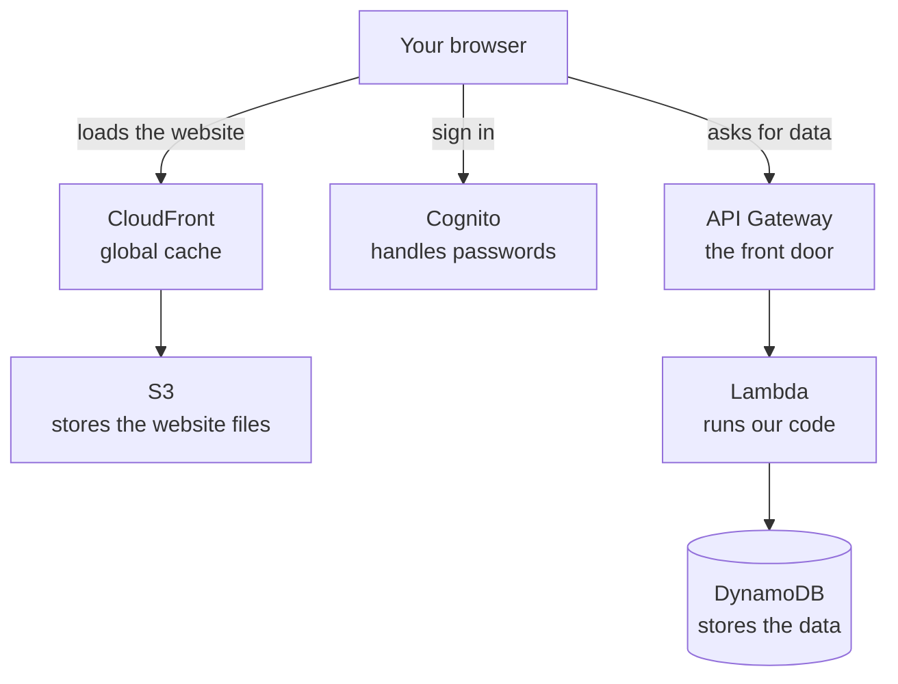

# LifeLink From Zero

**Start here.** No prior knowledge of the project assumed. By the end of this
document you will be able to explain what LifeLink is and why it is built the
way it is.

---

## 1. The problem

A hospital in Patiala needs four units of O-negative blood for a patient,
urgently.

Today, finding it means phoning blood banks one at a time. Each call takes
minutes. Some do not answer. Some say "let me check" and call back. Some say
yes and then the units are gone by the time someone arrives, because a
different hospital was told yes at the same time.

**The problem is not a shortage of blood. It is a shortage of information about
where the blood is.**

That distinction matters, and it is worth stating clearly: LifeLink does not
create blood supply. It solves a **coordination** problem.

---

## 2. What LifeLink is

A web platform where:

- **Blood banks** record what stock they have, batch by batch.
- **Hospitals** search for what they need near them and request a temporary
  hold on specific units.
- **Donors** find blood donation camps, register, and see their donation
  history.
- **Hospitals** can raise an urgent request that the system sends to several
  candidate providers in a sensible order.

It is a **demonstration project** running on real AWS infrastructure with
**synthetic data**. That is not a weakness to hide — it is stated on the site
itself, because a system displaying blood availability could cause real harm if
anyone mistook invented figures for real ones.

---

## 3. The four features

### Feature 1 — Blood bank inventory management

A blood bank records stock **by batch**, not as a single number. Each batch has
a blood group, a component (red cells, plasma, platelets), a unit count, an
expiry date, and two timestamps: when it was last **updated** and when it was
last independently **verified**.

**Why batches rather than one total?** Because blood expires. A total of "12
units" is useless if eight expire tomorrow. And because an audit trail needs to
know *which* units moved.

### Feature 2 — Discovery and location

A user shares their location (or searches for a place), chooses a blood group
and component, and sees nearby facilities ranked by distance, availability and
**how fresh the data is**.

They can then request a **temporary reservation** — a hold on specific units
with a countdown — which the blood bank accepts, rejects, or lets expire.

### Feature 3 — Donation camps and donor engagement

Organizers create camps; a platform admin approves them. Donors find camps
nearby and register. At the camp, staff check donors in and record donations,
which are then verified and credited to the donor's impact score.

### Feature 4 — Smart emergency coordination

A hospital raises an urgent request. A background job runs **every minute**,
ranks candidate providers by distance, availability and data freshness, and
records a dispatch to each. Providers respond; a response can be confirmed.
Clinical priority can be **certified**, but only by authorised hospital roles.

---

## 4. The five rules that shape everything

**These appear throughout the code and documentation. If you remember nothing
else, remember these — they are the strongest thing you can say about the
project's engineering.**

### 1. Unknown is not zero

A blood bank that has **never reported** its stock is not a blood bank with
**no** stock.

| State | Shown as | What a doctor does |
|---|---|---|
| `UNKNOWN` | "Not reported" — **no number** | phone them |
| `UNAVAILABLE` | "None in stock" | do not phone them |

Rendering `UNKNOWN` as 0 would be a lie with clinical consequences. **40 tests
exist for this one rule.**

### 2. Updated is not verified

Someone typing a number is different from someone independently checking it.
So there are two timestamps, two thresholds, and **two separate badges** — and
`inventory:write` and `inventory:verify` are even separate permissions.

### 3. An offer is not a reservation

A provider saying "we have units" is not a hold on those units. The UI says
**"Accepted — units held"**, never "approved". An availability alert is
informational and holds nothing — there is a UI component whose only job is to
say so.

### 4. Dispatch order is not clinical priority

The ranking decides who gets **asked first**, based on distance, stock and data
freshness. It never decides who **deserves** blood. That is a medical judgement
the system records and does not make.

### 5. Fail closed

If authorisation cannot be determined, the request is **refused**, not allowed.

---

## 5. How it is built, in one picture

**In words.** The website itself is just files — HTML, JavaScript, CSS — stored
in S3 and delivered worldwide by CloudFront. When you sign in, Cognito handles
the password and gives your browser a signed token. When the page needs data,
it calls API Gateway, which hands the request to a Lambda function. That
function checks your token, works out what you are allowed to see, reads or
writes DynamoDB, and returns JSON.

**There is no server.** Nothing runs continuously. The Lambda function exists
only for the few hundred milliseconds it takes to handle your request, and we
pay only for those milliseconds.

---

## 6. Why serverless, in plain terms

| If we ran a server | What we actually do |
|---|---|
| Pay for it 24 hours a day | Pay per request |
| Patch the operating system | AWS does it |
| Decide how big it should be | AWS scales it |
| It falls over at 3 a.m. | there is nothing to fall over |
| **Costs dollars a month minimum** | **costs $0.00 net** (about $0.45-0.50 gross, covered by credits) |

**The honest trade-offs:**

- **Cold starts.** The first request after a quiet period takes a few hundred
  extra milliseconds while AWS creates the environment.
- **A concurrency ceiling.** Our account allows **10** functions running at
  once, not the usual 1000. That single number shaped much of the
  architecture.

---

## 7. The numbers

| | |
|---|---|
| AWS account | `426150327442`, region `ap-southeast-2` (Sydney) |
| Live site | `https://d324z37do52g8f.cloudfront.net` |
| Deployed AWS resources | **66** |
| DynamoDB tables | **12**, with 24 indexes |
| Rows of demo data | **742** |
| API endpoints | **58** (9 open to anonymous users) |
| Lambda functions | **6** |
| Permissions / roles | **39 / 10** |
| Automated tests | **951**, all passing |
| Cost | **$0.00 net/month** (gross ~$0.45-0.50, offset by FREE-plan credits) |

---

## 8. What is honestly incomplete

**Learn this list. Being straight about it is worth more than a bluff that
collapses under one follow-up question.**

| # | Limitation |
|---|---|
| 1 | **No browser testing by a person.** 951 automated tests cover the code and the API. No browser automation exists in this project, and **12 manual checks remain unperformed** |
| 2 | **Demo data ages out.** After 48 hours everything shows "Outdated". Re-run the seeder before a demo |
| 3 | **Email and SMS are not sending.** Notifications are in-app only. The notification worker Lambda has never been invoked |
| 4 | **The map basemap is OpenStreetMap, not AWS.** Creating an Amazon Location API key is denied by the account's policy |
| 5 | **Alarms notify nobody.** Eight CloudWatch alarms publish to an SNS topic with zero subscriptions |
| 6 | **All data is synthetic.** Real Punjab facility data was attempted; the public sources were unreachable |

---

## 9. The two-minute explanation

**Practise saying this out loud until it is comfortable.**

> "LifeLink is a blood availability platform for Punjab. The problem it solves
> isn't a shortage of blood — it's that when a hospital needs blood urgently,
> nobody knows which nearby blood bank actually has it, so they phone around and
> waste time they don't have.
>
> It does four things. Blood banks record their stock batch by batch, with
> expiry dates. Hospitals search for what they need nearby and can request a
> temporary hold on specific units. Donors find donation camps and register.
> And a hospital can raise an urgent request that the system automatically sends
> to several candidate providers, ranked by distance and how recently their data
> was updated.
>
> It's built entirely serverless on AWS. The website is static files in S3
> served through CloudFront. The backend is one Lambda function behind an HTTP
> API, which checks the user's Cognito token and reads twelve DynamoDB tables.
> Five more Lambdas handle scheduled and queued background work. The whole thing
> costs nothing net because nothing runs when nobody's using it — gross usage
> is about forty-five to fifty cents a month, fully covered by credits.
>
> The design principle I'd highlight is honesty about data. A blood bank that's
> never reported its stock is not a blood bank with zero stock — those lead a
> doctor to opposite actions — so we show 'not reported' with no number, and we
> have forty tests enforcing just that one rule. Similarly, data being recently
> updated is different from being independently verified, so we track and display
> those separately.
>
> And one honest limitation: the API and the AWS resources were verified by
> script — fifty-six live checks — but the browser workflows haven't been
> independently watched by a person. There are twelve manual checks still
> outstanding."

---

## 10. What to read next

| Next | Why |
|---|---|
| [03_Project_Features_And_User_Roles.md](03_Project_Features_And_User_Roles.md) | the four features and ten roles in detail |
| [../02_SYSTEM_ARCHITECTURE/01_Complete_System_Architecture.md](../02_SYSTEM_ARCHITECTURE/01_Complete_System_Architecture.md) | the architecture properly |
| [04_Technology_Stack_Explained.md](04_Technology_Stack_Explained.md) | every technology and why |
| [../02_SYSTEM_ARCHITECTURE/02_End_To_End_Data_Flow.md](../02_SYSTEM_ARCHITECTURE/02_End_To_End_Data_Flow.md) | one request traced all the way down |
