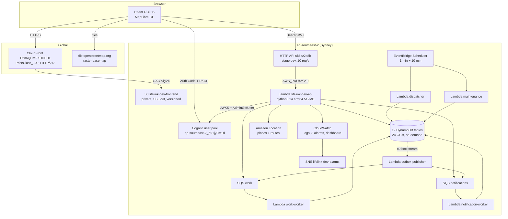

# Complete System Architecture

**Read this once slowly, then redraw the diagram from memory. If you can draw
it, you can explain the project.**

---

## 1. The architecture in one sentence

A React single-page application served from S3 through CloudFront calls one
HTTP API, which proxies every request to a single Lambda function that
authenticates the caller itself and reads or writes twelve DynamoDB tables,
while five more Lambda functions handle scheduled and queued background work.

---

## 2. The diagram



---

## 3. Every layer, and why it is there

### Layer 1 — the browser

React 18 with Vite 6, built to static files. There is no server-side
rendering. The browser downloads HTML, JavaScript and CSS, then talks to the
API directly.

Why a single-page application? Because the thing that costs money and
complexity in a web app is a running server. A SPA needs no server at all for
the user interface — only static file hosting, which is the cheapest and most
reliable thing a cloud provider sells.

### Layer 2 — CloudFront (global)

`DEPLOYED`: distribution `E236QHMFXHDEDL`, serving
`https://d324z37do52g8f.cloudfront.net`.

CloudFront is a **content delivery network**: a global set of edge locations
that cache your files close to users. It does four jobs here:

1. **Serves the site over HTTPS** with an AWS-provided certificate. S3 static
   website hosting cannot do HTTPS on its own.
2. **Keeps the S3 bucket private.** An Origin Access Control signs CloudFront's
   requests to S3, and the bucket policy accepts only those. The bucket has all
   four public access blocks on.
3. **Caches** with the AWS managed `CachingOptimized` policy, and compresses.
4. **Makes deep links work.** Custom error responses map both **403 and 404 to
   `/index.html` with status 200**. Without this, visiting
   `/facilities/fac-123` directly would 404, because no such file exists in
   S3 — React Router resolves the path in the browser.

That last point is the single most useful CloudFront detail to know, because
it explains a behaviour a teacher can see.

### Layer 3 — Cognito (authentication)

`DEPLOYED`: user pool `ap-southeast-2_Z91jyFm1d`, one public app client.

The browser never sends a password to LifeLink's own code. It redirects to
Cognito's hosted login, and Cognito returns an authorization code which the app
exchanges for JWTs using PKCE. See
[../08_SECURITY_AND_RELIABILITY/01_Cognito_Authentication_Flow.md](../08_SECURITY_AND_RELIABILITY/01_Cognito_Authentication_Flow.md).

### Layer 4 — HTTP API (API Gateway v2)

`DEPLOYED`: `uk6itz2a5b`, stage `dev`.

**It is an HTTP API, not a REST API.** Different AWS product, different Console
page, roughly 70% cheaper, fewer features. Get this right.

It has exactly **two routes**:

| Route | Authorization | Target |
|---|---|---|
| `ANY /{proxy+}` | **NONE** | `lifelink-dev-api` |
| `ANY /` | **NONE** | `lifelink-dev-api` |

**There is no Cognito authorizer.** Every request reaches the Lambda, which
does its own authentication. Why? Because authorization here is not a simple
"is this token valid" question — it needs the user's role from the database,
their account status, and an organization scoping check. A gateway authorizer
can only answer the first part, so putting it there would split the logic
across two places and still require the Lambda to do most of it.

The honest trade-off: unauthenticated requests still invoke a Lambda and cost
money, and the gateway cannot reject them for free. The stage throttle (10
requests/second, burst 20) is what limits that exposure.

### Layer 5 — the API Lambda

`DEPLOYED`: `lifelink-dev-api`, `python3.14`, `arm64`, 512 MB, 29 s timeout.

One function serves all 58 routes. Inside it:

```
lambda_handler  (handlers/api.py)
   -> Router.dispatch  (handlers/router.py)
        -> strip_stage_prefix       # "/dev/health" becomes "/health"
        -> match the route
        -> @requires(permission)    # appcore/auth.py — 5 ordered checks
        -> handler function         # handlers/api.py
             -> service             # services/*.py — orchestration
                  -> domain         # domain/*.py — pure rules, no AWS
                  -> repository     # repositories/*.py — DynamoDB
        -> response envelope        # appcore/responses.py
```

Why one function instead of 58? Three reasons, and a teacher may well ask:

1. **The concurrency ceiling is 10.** Fifty-eight functions competing for ten
   concurrent executions would be worse than one.
2. **Cold starts.** One function stays warm across all routes; fifty-eight each
   go cold.
3. **Simplicity.** One deployment package, one role to review, one log group to
   read.

The cost: the IAM role is the union of every route's needs, so it is broader
than any single route requires. That is a real downside — acknowledge it.

### Layer 6 — DynamoDB

`DEPLOYED`: 12 tables, 24 global secondary indexes, on-demand billing.

See [../05_DATABASE_AND_DATA/01_DynamoDB_Data_Model.md](../05_DATABASE_AND_DATA/01_DynamoDB_Data_Model.md).

### Layer 7 — background work

Three mechanisms, all `DEPLOYED`:

**Scheduled.** EventBridge **Scheduler** invokes `lifelink-dev-dispatcher`
every minute and `lifelink-dev-maintenance` every ten minutes. Note: this is
`AWS::Scheduler::Schedule`, the newer service — **not** EventBridge Rules, and
**not** Step Functions. There are zero Step Functions in this project.

**Event-driven.** A write and its outbound event commit together in one
`TransactWriteItems` to the `outbox` table. A DynamoDB Stream on that table
triggers `lifelink-dev-outbox-publisher`, which fans events out to SQS. This is
the **transactional outbox pattern**: an event can never be published for a
write that rolled back, and can never be lost after a write that committed.

**Queued.** `lifelink-dev-work-worker` and
`lifelink-dev-notification-worker` consume their queues, each capped at
`MaximumConcurrency: 2` so they cannot starve the API function of the shared
pool of ten.

### Layer 8 — observability

8 CloudWatch alarms, a dashboard named `LifeLink-dev`, X-Ray tracing Active on
all six functions, and JSON access logs from the API stage.

**Honest gap found during this documentation pass:** the alarm SNS topic
`lifelink-dev-alarms` has **zero subscriptions**. All eight alarms fire into a
topic nobody receives. Also, only the two log groups declared in the template
have 30-day retention; the four that Lambda auto-created **never expire**.

---

## 4. What is deliberately *not* in the architecture

Knowing what you did not use, and why, is often worth more marks than the
list of what you did.

| Not used | Why |
|---|---|
| **Step Functions** | No workflow here needs durable multi-step orchestration with human-scale waits. A scheduled dispatcher plus queues is simpler and cheaper. Zero occurrences in the template. |
| **EC2** | Nothing needs a persistent server. Patching and idle cost for no benefit. |
| **RDS** | Access patterns are key-based and known in advance; on-demand DynamoDB costs almost nothing at this volume. |
| **API Gateway REST API** | HTTP API does everything needed at a fraction of the cost. |
| **Lambda@Edge / CloudFront Functions** | Excluded by the account's policies, and no need. |
| **Cognito groups** | Roles need to be revocable immediately and are organization-scoped, so they live in DynamoDB and are read per request. |
| **A second database** | One store, one failure mode. |
| **Container orchestration (ECS/EKS)** | Enormous overhead for a request/response API. |
| **Amazon Location browser tiles** | `AWS::Location::APIKey` is denied by the account's SCP. See ADR-0019. |
| **SMS** | ADR-0015, and blocked by the SCP. |

---

## 5. How the layers fail, and what the user sees

| Failure | Effect | Handling |
|---|---|---|
| CloudFront edge fails | another edge serves it | automatic |
| S3 unavailable | site will not load | no mitigation; S3 is the single source for the UI |
| Lambda throttled (>10 concurrent) | 429 from the gateway or a throttle error | gateway throttles at 10 req/s first; alarm `lifelink-dev-lambda-throttles` |
| Lambda errors | 500 with a correlation id | alarm `lifelink-dev-api-errors` at >5 in 5 min |
| DynamoDB throttled | write fails, surfaced as an error | on-demand scales automatically; alarm `lifelink-dev-inventory-throttles` |
| Token expired | 401 | frontend clears the session and redirects to sign-in |
| Queue consumer keeps failing | message retried, then moved to the DLQ after 5 receives | DLQ alarms exist (but see the SNS gap above) |
| Amazon Location unavailable | no road distance or ETA | UI says directions are unavailable; it **never invents a distance** |
| OSM tiles unavailable | blank basemap, markers still render | map fallback message |

---

## 6. Spoken answers

### 20–30 seconds

> "It's fully serverless. The React frontend is built to static files, stored
> in a private S3 bucket, and served worldwide through CloudFront over HTTPS.
> The frontend calls an HTTP API, which passes every request to a single Lambda
> function. That Lambda checks the user's Cognito token itself, looks up their
> role in DynamoDB, and then reads or writes one of twelve DynamoDB tables.
> Five more Lambdas handle scheduled and queued background work. Everything
> regional is in ap-southeast-2."

### 1–2 minutes

> "The architecture has three parts: hosting, request handling, and background
> work.
>
> For hosting, the React app is compiled to static files and uploaded to S3.
> The bucket is completely private — CloudFront reaches it using an Origin
> Access Control, which means S3 only accepts requests signed by our
> distribution. CloudFront gives us HTTPS and global caching, and it also maps
> 403 and 404 responses to index.html so that React Router's deep links work.
>
> For request handling, the browser gets a JWT from Cognito using the
> authorization code flow with PKCE, then sends it as a Bearer token to our
> HTTP API. The API has only two routes — a root and a catch-all proxy — and
> both forward to one Lambda function. We deliberately did not use a Cognito
> authorizer on the gateway, because our authorization needs the user's role
> and account status from DynamoDB, not just a valid signature. So the Lambda
> does all five checks in one place: signature, user lookup, account status,
> permission, and organization scoping.
>
> For background work, anything that shouldn't block a response goes into an
> outbox table in the same transaction as the main write. A DynamoDB Stream
> picks that up and fans it out to SQS queues, where worker Lambdas consume it.
> Two more Lambdas run on EventBridge Scheduler — a dispatcher every minute and
> maintenance every ten minutes.
>
> The constraint that shaped most of this is that our account's Lambda
> concurrency limit is 10, not the usual 1000. So the gateway throttles at 10
> requests a second and each queue consumer is capped at 2 concurrent
> executions."

---

## 7. Difficult follow-up questions

**"Why not put a Cognito authorizer on API Gateway? That's the standard
pattern."**
> Because it only solves a third of the problem. An authorizer validates the
> token signature, but our authorization also depends on the user's role, which
> lives in DynamoDB and must be revocable immediately, and on an organization
> scoping check. If we used an authorizer we'd still need the Lambda to do
> those, so the logic would be split across two places. Keeping all five checks
> in one decorator means one reviewable place and a test that enumerates every
> route to prove none is unprotected. The cost is that invalid requests still
> invoke a Lambda — which is why the stage throttles at 10 per second.

**"One Lambda for 58 routes — isn't that a monolith?"**
> It is, deliberately. With a concurrency ceiling of 10, splitting into 58
> functions would make contention worse, multiply cold starts, and give us 58
> log groups to search. The genuine downside is that the IAM role is the union
> of all routes' needs, so it is broader than any individual route requires.
> If the concurrency limit were 1000 and the team were bigger, splitting by
> feature would be the better call.

**"What happens if two Lambdas write the same inventory batch at once?"**
> Conditional writes. The batch row carries a `version` attribute and updates
> are conditioned on it, so the second write fails instead of silently
> overwriting. For reservations we go further and use `TransactWriteItems` so
> the reservation row and the pool counter move together. We verified live that
> a second requester against a fully-held pool is refused with
> `NO_UNRESERVED_STOCK`.

**"Where is the single point of failure?"**
> S3 holding the frontend bundle. If that object is unavailable, the UI will
> not load no matter how healthy everything else is. We mitigate accidental
> loss with versioning on the bucket, but not a regional outage. The honest
> answer is that this is a single-Region demonstration deployment, and
> multi-Region was impossible here anyway — the account only permits one
> Region.

**"How would this handle a thousand concurrent users?"**
> It would not, as configured. The gateway throttles at 10 requests per second
> because the account's Lambda concurrency limit is 10. DynamoDB on-demand and
> CloudFront would both cope fine. To scale, you would raise the Lambda
> concurrency limit, raise the stage throttle, and probably split the API
> function by feature so a slow route cannot consume the whole pool. The
> architecture does not need to change — the limits do.

---

## 8. Cross-references

- Request tracing: [02_End_To_End_Data_Flow.md](02_End_To_End_Data_Flow.md)
- The HTTP conversation: [03_Frontend_To_Backend_Communication.md](03_Frontend_To_Backend_Communication.md)
- AWS resource inventory: [04_AWS_Architecture.md](04_AWS_Architecture.md)
- Why each decision was made: [05_Architecture_Decisions.md](05_Architecture_Decisions.md)
- Diagrams to copy into a report: [02_End_To_End_Data_Flow.md](02_End_To_End_Data_Flow.md)
