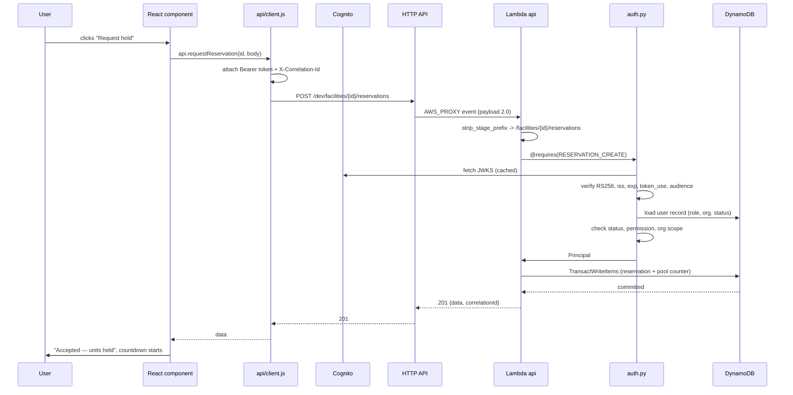
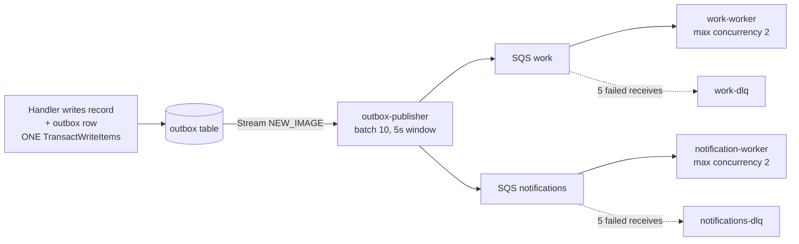

# End-to-End Data Flow

**This is the most useful document in the library for a viva.** If you can
trace one request from a click to a database row and back, you can answer
almost any "how does it work" question by picking the right stop on the
journey.

We trace one real request: **a hospital user asks a blood bank to hold 2 units
of O-negative red cells.**

---

## 1. The journey at a glance



---

## 2. Step by step, with the actual code

### Step 1 — the click

**File:** `frontend/src/features/discovery/ReservationPanel.jsx`

A form collects blood group, component and units. The submit handler calls the
API client. The component itself contains no URL and no header logic — that is
deliberate, so there is exactly one place where requests are shaped.

### Step 2 — the API client builds the request

**File:** `frontend/src/api/client.js`

```javascript
requestReservation: (facilityId, body) =>
  data('POST', `/facilities/${facilityId}/reservations`, { body }),
```

Everything then goes through one `request()` function, which:

1. Sets `Accept: application/json`.
2. Generates an `X-Correlation-Id` of the form `web-<uuid>`.
3. Calls `tokenProvider()` and, if a token exists, sets
   `Authorization: Bearer <token>`.
4. Sets `Content-Type: application/json` when there is a body.
5. Sets `Idempotency-Key` when the caller supplied one.

**Why one place?** So that error shapes, correlation ids, idempotency keys and
auth headers are handled once instead of in each of the 50-odd components. A
component cannot forget the token, because the component never sees it.

**Why does the client not store the token?** `setTokenProvider()` is called
once by `frontend/src/auth/AuthContext.jsx`. The client holds a *function*, not
a token, so there is no second copy of the session to go stale.

### Step 3 — the network request

```http
POST /dev/facilities/fac-bb-patiala-1/reservations HTTP/1.1
Host: uk6itz2a5b.execute-api.ap-southeast-2.amazonaws.com
Authorization: Bearer eyJraWQiOiJ...
Content-Type: application/json
X-Correlation-Id: web-3f9c...

{"bloodGroup":"O-","component":"RED_CELLS","units":2}
```

Note `/dev/` — the stage name is part of the URL because
`VITE_API_BASE` ends in `/dev`.

### Step 4 — API Gateway

The HTTP API matches `ANY /{proxy+}` and forwards an `AWS_PROXY` event in
**payload format 2.0** to `lifelink-dev-api`, with a 30-second integration
timeout. `AuthorizationType` is `NONE`, so the gateway does **no** token
checking. It also writes a JSON access log line to
`/aws/apigateway/lifelink-dev` containing the request id, source IP, method,
route key, status and latency.

### Step 5 — the Lambda entry point and the stage prefix

**File:** `backend/src/handlers/api.py` -> `lambda_handler`
**File:** `backend/src/handlers/router.py` -> `strip_stage_prefix`

The gateway reports `rawPath` as `/dev/facilities/...`, but the route table is
written as `/facilities/...`. `strip_stage_prefix()` removes a leading segment
that **exactly equals** `requestContext.stage`:

```python
stage = ((event.get("requestContext") or {}).get("stage") or "").strip()
if not stage or stage == "$default":
    return raw_path
prefix = f"/{stage}"
if raw_path == prefix:
    return "/"
if raw_path.startswith(prefix + "/"):
    return raw_path[len(prefix):]
return raw_path
```

**This is worth telling a teacher about,** because it is a real bug that was
found by deploying: every route worked locally and 404'd in AWS. The stage is
read from the event rather than hard-coded, so renaming the stage cannot
silently reintroduce the bug, and only an exact segment match is stripped so a
route like `/dev-tools` is untouched.

### Step 6 — route matching

`Router.match()` compiles `/facilities/{facilityId}/reservations` into the
regex `^/facilities/(?P<facilityId>[^/]+)/reservations$`. If a path matches but
the method does not, the router remembers that so it can answer **405** rather
than 404 — a small correctness detail that distinguishes "wrong method" from
"no such thing".

### Step 7 — authentication and authorization, in a fixed order

**File:** `backend/src/appcore/auth.py`

The handler is wrapped in `@requires(Permission.RESERVATION_CREATE)`. Five
checks run in this order, and the order is the point:

| # | Check | Failure |
|---|---|---|
| 1 | RS256 signature against the pool's JWKS, plus `iss`, `exp`, `token_use` and audience | `401 UNAUTHENTICATED` |
| 2 | Load the user record **from DynamoDB** | `401` if unknown |
| 3 | Account status | `403 ACCOUNT_SUSPENDED` |
| 4 | Permission held by the role | `403 FORBIDDEN` |
| 5 | Organization scoping | `403` cross-organization |

**Why load the role from the database instead of the token?** Because a token
lives for an hour. If roles came from claims, revoking someone's access would
take up to an hour to take effect. Reading stored state means a revoked role
applies on the **very next request**. The cost is one extra DynamoDB read per
request — a few milliseconds, and worth it.

The audience check is per token type, because Cognito puts the audience in
different claims:

```python
presented = claims.get("client_id") if token_use == "access" else claims.get("aud")
```

See [../08_SECURITY_AND_RELIABILITY/03_JWT_And_Token_Verification.md](../08_SECURITY_AND_RELIABILITY/03_JWT_And_Token_Verification.md).

### Step 8 — the handler, the service, the domain, the repository

Four layers, each with one job:

| Layer | File | Responsibility | Knows about AWS? |
|---|---|---|---|
| Handler | `handlers/api.py` | parse and validate input, shape the response | yes (the event) |
| Service | `services/reservation_service.py` | orchestrate the use case | yes (repositories) |
| Domain | `domain/reservations.py` | the rules | **no** |
| Repository | `repositories/reservation_repo.py` | DynamoDB calls | yes |

**Why keep the domain layer free of AWS imports?** Because rules are what you
most want to test, and tests that need no AWS run in milliseconds. That is why
566 of the 657 backend tests are unit tests.

### Step 9 — the transactional write

**File:** `backend/src/repositories/reservation_repo.py`

Two things must change together: a new `RESERVATION` row, and the
`RESERVATION_POOL` row's `heldUnits` counter. They are written in a single
`TransactWriteItems` with a condition that the pool still has enough
unreserved units.

If two users request the last 2 units simultaneously, exactly one transaction
commits and the other fails its condition. Verified live: the loser receives
`NO_UNRESERVED_STOCK`.

### Step 10 — the response envelope

**File:** `backend/src/appcore/responses.py`

Success:
```json
{ "data": { "reservationId": "...", "status": "PENDING", "expiresAt": "..." },
  "correlationId": "corr-c77986b2-9ded-4963-8ff1-bf271402fe2a" }
```

Failure:
```json
{ "error": { "code": "NO_UNRESERVED_STOCK", "message": "...", "details": {} },
  "correlationId": "corr-..." }
```

**Every** response carries a `correlationId`. That same id appears in the
CloudWatch log line for the request, which is how you trace one browser action
to one log entry during a demonstration. Practise this — it is impressive and
takes thirty seconds.

### Step 11 — back in the browser

`request()` reads the response. On a non-2xx it throws an `ApiError` carrying
the backend's stable `code`, the HTTP status, details and the correlation id.
`ApiError` exposes two computed properties the UI relies on:

```javascript
get isRetryable() {
  return this.status >= 500 || this.status === 0 ||
         this.code === 'RATE_LIMITED' || this.code === 'CONCURRENT_MODIFICATION'
}
get isAuthError() { return this.status === 401 || this.code === 'UNAUTHENTICATED' }
```

So the UI decides whether to offer "try again" or to send the user to sign in
based on the error itself, not on string matching.

### Step 12 — the user sees the result

**File:** `frontend/src/features/reservations/reservationView.js`

`statusLabel()` maps `PENDING` to **"Awaiting the blood bank"** and `CONFIRMED`
to **"Accepted — units held"**. It never says "approved", because approval
implies a clinical judgement the system does not make. An offer is not a
reservation.

---

## 3. The same journey for a read: Find Blood

```
FindBloodPage.jsx
  -> api.searchFacilities({lat, lon, radiusKm, bloodGroup, component})
  -> GET /facilities?lat=...&lon=...
  -> HTTP API -> Lambda
  -> @requires(FACILITY_READ) with allow_anonymous=True
       (anonymous callers get the PUBLIC role's 4 permissions)
  -> services/discovery_service.py
  -> domain/geo.py  choose_precision(radiusKm) -> 4, 5 or 6
  -> domain/geo.py  search_cells(...) -> list of geohash cells
  -> repositories/facility_repo.py  Query GSI5-geo4 / GSI1-geo5 / GSI2-geo6
  -> domain/geo.py  haversine_km() to filter the cell results to a true circle
  -> domain/freshness.py  label each facility FRESH/AGING/STALE/OUTDATED
  -> domain/ranking.py  order by distance, availability and freshness
  -> {data: [...], meta: {effectiveRadiusKm: 20, ...}}
```

**Why geohash cells then haversine?** DynamoDB cannot answer "within 20 km of
this point". It can answer "partition key equals this geohash prefix". So the
code converts a circle into a set of square cells, queries those cells by
index, and then filters the results to the true circle with the haversine
formula. The cells over-cover the circle, so the second filter is what makes
the answer correct.

---

## 4. The background path: how an event travels



**Why an outbox instead of publishing to SQS directly from the handler?**
Because "write to DynamoDB, then send to SQS" has two failure modes: the write
succeeds and the send fails (event lost), or the send succeeds and the write
rolls back (event for something that never happened). Writing the event into
the same transaction as the data makes both impossible. The stream then
delivers it at least once, and consumers are idempotent.

The outbox table is **empty (0 rows)** right now, which is the correct steady
state — rows are consumed and then expire by TTL.

---

## 5. Spoken answers

### 20–30 seconds

> "A click calls one function in our API client, which attaches the Cognito
> access token and a correlation id. That goes to the HTTP API, which proxies
> it to a single Lambda. The Lambda strips the stage prefix, matches the route,
> then runs five checks in order — token signature, user lookup from DynamoDB,
> account status, permission, and organization scope. Then the handler calls a
> service, the service uses pure domain logic for the rules and a repository
> for the DynamoDB write, and the response comes back wrapped with the same
> correlation id so we can find it in CloudWatch."

### 1–2 minutes

Add the transaction and the honesty detail:

> "For a reservation specifically, two things have to change together: the
> reservation row and a pool counter that tracks how many units are held. We
> write both in one DynamoDB `TransactWriteItems` with a condition on the pool
> still having enough unreserved units. That's what stops two people reserving
> the same last two units — one transaction commits and the other fails its
> condition. We verified that live: the second requester gets
> `NO_UNRESERVED_STOCK`.
>
> We actually found a real bug in this exact path after deploying. The
> condition deciding whether to release held units asked 'was this reservation
> holding units' instead of 'does it stop holding units', so confirming a
> reservation released its own hold. Nine hundred passing tests didn't catch
> it; exercising the deployed system did. We added six regression tests — four
> of them failed against the old code — and re-verified all three transition
> paths with the counters read straight out of DynamoDB."

---

## 6. Follow-up questions

**"How do you know a request didn't get authorized by accident?"**
> Every route declares the permission it needs in the route table, and a test
> enumerates that table and fails the build if any route is missing
> authorization metadata. So "no endpoint was left unprotected" is a checked
> property, not a hope. Anonymous routes still declare a permission — they are
> served to a `PUBLIC` principal that holds only four permissions.

**"What if the token is valid but the user was just suspended?"**
> They get 403 `ACCOUNT_SUSPENDED`. That is check three of five, and it runs
> before the permission check. We verified it live with a suspended demo
> account holding a freshly issued, perfectly valid token.

**"Where would you look if a request failed in the browser?"**
> DevTools Network tab for the status and the response body, which contains the
> error code and the correlation id. Then CloudWatch Logs Insights on
> `/aws/lambda/lifelink-dev-api`, filtering for that correlation id, which
> gives the server side of the same request.

**"Is the idempotency key actually used?"**
> Yes, for creates that must not double-apply — `POST /alerts`, batch creation,
> camp registration, and emergency request creation. The client generates it
> and the backend records it in the `idempotency` table with a TTL. That table
> is empty right now because the entries expire.

---

## 7. Cross-references

- [01_Complete_System_Architecture.md](01_Complete_System_Architecture.md)
- [03_Frontend_To_Backend_Communication.md](03_Frontend_To_Backend_Communication.md)
- [../03_REPOSITORY_AND_CODE/04_API_And_Handler_Mapping.md](../03_REPOSITORY_AND_CODE/04_API_And_Handler_Mapping.md)
- [../06_FEATURE_IMPLEMENTATION/05_Temporary_Reservations.md](../06_FEATURE_IMPLEMENTATION/05_Temporary_Reservations.md)
- [../05_DATABASE_AND_DATA/06_Concurrency_And_Data_Integrity.md](../05_DATABASE_AND_DATA/06_Concurrency_And_Data_Integrity.md)
