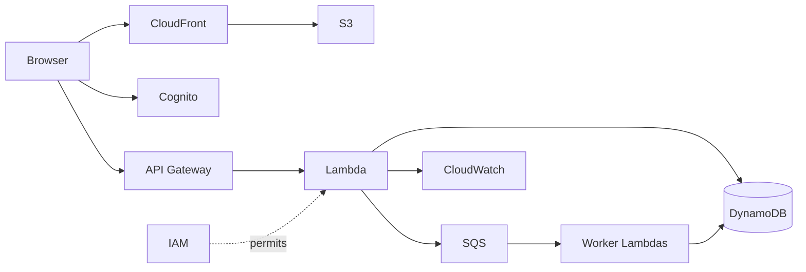

# AWS Introduction for LifeLink

For someone who has not used AWS before. Read this before the per-service
documents.

---

## 1. What "the cloud" actually means

**The honest definition.** Someone else's computers, in someone else's
building, rented by the hour or by the request, reached over the internet
through an API.

The useful part is not that the computers are elsewhere. It is that:

- You can **create** a database or a server with one API call.
- You can **destroy** it just as easily and stop paying.
- You never buy, install, patch or dispose of hardware.
- You pay for what you use, and in many cases **nothing when idle**.

**Why that changes how you design.** When a server takes six weeks to procure,
you buy one big one and put everything on it. When it takes six seconds, you
use the right tool for each job — which is why LifeLink has twelve small
databases rather than one large one, and six small functions rather than one
application server.

---

## 2. The three service models

| Model | You manage | Analogy | Example |
|---|---|---|---|
| **IaaS** — Infrastructure as a Service | OS, runtime, your code | renting an empty flat | EC2 |
| **PaaS** — Platform as a Service | runtime config, your code | a serviced apartment | Elastic Beanstalk |
| **FaaS / Serverless** | **only your code** | a hotel room, charged per night | **Lambda** |

**LifeLink is entirely serverless.** There is no server in this project that
anyone logs into, patches, or restarts. That is a true statement and a strong
one — make sure you can defend it, because the obvious follow-up is "so where
does the code actually run?"

**The answer:** AWS runs it in a micro-VM that it creates on demand and
destroys afterwards. There *is* a computer; we simply never see it, name it, or
pay for it when it is idle.

---

## 3. "Serverless" — what it does and does not mean

| Myth | Reality |
|---|---|
| "There are no servers" | There are. AWS manages them and you never touch one |
| "It scales infinitely" | It scales automatically **up to a limit**. Ours is 10 concurrent executions |
| "It's always cheaper" | Cheaper when traffic is spiky or low. More expensive per request at steady high volume |
| "No operational work" | Less, but you still own monitoring, permissions, cost and failure handling |

**Say this if asked what serverless means:**
> "It means we never provision or manage a server. We upload code, and AWS runs
> it when a request arrives and charges per request. There are still servers —
> we just don't see them, name them, or pay for them when they're idle. The
> trade-offs are real: cold starts on the first request after a quiet period,
> and a hard concurrency limit. Ours is ten, which is actually the constraint
> that shaped most of our architecture."

---

## 4. The nine AWS services LifeLink uses

| Service | One-line job | Analogy | In LifeLink |
|---|---|---|---|
| **S3** | file storage | a warehouse | the React build; 2 buckets |
| **CloudFront** | global content delivery | local shops stocking copies | serves the site over HTTPS |
| **API Gateway** | public API front door | a receptionist | HTTP API `uk6itz2a5b` |
| **Lambda** | run code on demand | a rideshare, not a hired car | 6 functions |
| **DynamoDB** | NoSQL database | a vast dictionary | 12 tables, 742 rows |
| **Cognito** | user sign-up and sign-in | a passport office | 1 user pool, 11 users |
| **IAM** | who may do what | a keycard system | 9 roles, 0 users |
| **SQS** | message queue | an in-tray | 4 queues |
| **CloudWatch** | logs, metrics, alarms | a flight recorder | 6 log groups, 8 alarms |

Plus four supporting services: **SNS** (alarm notifications),
**EventBridge Scheduler** (two timed jobs), **Amazon Location** (geocoding and
routing), and **Secrets Manager** (one secret).

---

## 5. Services LifeLink deliberately does not use

Knowing what you did not use, and why, is often worth more than the list of
what you did.

| Not used | Why |
|---|---|
| **EC2** | Nothing needs a persistent server |
| **RDS** | Access patterns are key-based; an RDS instance bills hourly whether used or not |
| **Step Functions** | **Zero in the template.** No workflow needs durable multi-step orchestration |
| **ECS / EKS** | Container orchestration is large overhead for a request/response API |
| **VPC / NAT Gateway** | Not needed — and a NAT Gateway alone would cost ~$32/month, about 80x our whole bill |
| **ElastiCache** | Nothing needs a cache layer at this volume |
| **SES** (configured) | The email seam exists but `SES_SENDER` is empty |
| **SNS for SMS** | ADR-0015, and blocked by the account's policies |
| **Lambda@Edge** | Excluded by the account's policies |
| **CloudFormation StackSets** | No multi-account or multi-Region deployment possible here |

**On Step Functions specifically:** if asked, say "we don't use it — you can
check the template, there are none. Our scheduling is EventBridge Scheduler."
**Do not claim an ADR rejects it by name**; none does. The template is the
evidence.

---

## 6. How the services connect



**IAM is drawn with a dashed line because it is not in the request path.** It
is not a service the application calls; it is the rule system AWS consults
before letting any call succeed. That distinction is worth understanding — it
is a common confusion.

---

## 7. This account is unusual, and you should say so

LifeLink runs on a **new AWS experience** account, which has real constraints a
teacher may not expect:

| Constraint | Consequence |
|---|---|
| **One Region only** | Everything regional is in `ap-southeast-2` (Sydney). Mumbai was not available |
| **No cross-Region actions** | No replication, no multi-Region KMS keys, no StackSets |
| **Lambda concurrency limit of 10** | Not the default 1000. This shaped the architecture |
| **Managed IAM for humans** | Users are invited by email; we do not create IAM users |
| **Service control policies** | Some actions are denied outright — including creating an Amazon Location API key, which forced ADR-0019 |
| **Not all services available** | A FREE-plan service list applies |

**Say this when asked about Region choice:**
> "Everything regional is in ap-southeast-2, Sydney. That's a constraint of our
> account rather than a choice — it's a new AWS experience project with a single
> assigned Region derived from the contact address, so Mumbai wasn't available
> even though our data is about Punjab. CloudFront softens it, because the static
> site is cached at an edge location near the user; only API calls actually
> travel to Sydney, about 150 milliseconds each way."

---

## 8. The vocabulary you need

| Term | Meaning |
|---|---|
| **Region** | A geographic cluster of data centres. Ours: `ap-southeast-2` |
| **Availability Zone** | One or more isolated data centres within a Region |
| **Global service** | Not tied to a Region: CloudFront, IAM |
| **ARN** | Amazon Resource Name — a globally unique id, e.g. `arn:aws:dynamodb:ap-southeast-2:426150327442:table/lifelink-dev-facilities` |
| **Account id** | Ours: `426150327442` |
| **Principal** | Whoever is making a request |
| **Role** | An identity something assumes temporarily |
| **Policy** | A JSON document granting or denying permissions |
| **CloudFormation** | Infrastructure as code — resources described in a file |
| **SAM** | Serverless Application Model — CloudFormation plus serverless shorthand |
| **Stack** | A deployed set of resources from one template. Ours: `lifelink-dev` |
| **Changeset** | A preview of what a deployment would change |
| **Drift** | When a live resource no longer matches its template |

### How to read an ARN

```
arn:aws:dynamodb:ap-southeast-2:426150327442:table/lifelink-dev-facilities
 |   |     |            |             |            |
 |   |   service      region      account      resource
 | partition
```

Being able to read an ARN out loud is genuinely useful during an evaluation,
because IAM policies are made of them.

---

## 9. Infrastructure as code — why it matters here

**Everything in LifeLink's AWS account exists because
`infrastructure/template.yaml` says so.** Nothing was clicked together by hand.

| Benefit | Why it matters |
|---|---|
| **Reproducible** | The whole stack can be recreated from one file |
| **Reviewable** | A permission change is a line in a diff |
| **Diffable** | A changeset shows exactly what a deployment will alter |
| **Documented** | The template *is* the documentation of what exists |

**And the limitation**, which is worth knowing because we hit it: a template
only controls the resources it declares. Four of our Lambda log groups were
created automatically by AWS on first invocation, so the template's 30-day
retention setting never reached them. That is an **IaC coverage gap** — a
different and more common problem than drift.

**Say this:**
> "The entire infrastructure is one SAM template, about fifteen hundred lines,
> deployed as a single CloudFormation stack. That means nothing was created by
> clicking in the Console, so the deployment is reproducible and any permission
> change shows up in a diff.
>
> It also taught me the limitation: a template only governs what it declares.
> Four of our Lambda log groups were created implicitly by AWS, so our retention
> setting never applied to them. That's not drift exactly — those resources were
> never in the stack — it's a coverage gap."

---

## 10. What to read next

| Next | Why |
|---|---|
| [02_Regions_And_Availability_Zones.md](02_Regions_And_Availability_Zones.md) | Where things physically are |
| [03_S3_And_CloudFront.md](03_S3_And_CloudFront.md) | How the site is hosted |
| [04_API_Gateway.md](04_API_Gateway.md) + [05_AWS_Lambda.md](05_AWS_Lambda.md) | How the backend runs |
| [06_DynamoDB.md](06_DynamoDB.md) | The database |
| [07_Cognito_Complete_Guide.md](07_Cognito_Complete_Guide.md) + [08_IAM_Complete_Guide.md](08_IAM_Complete_Guide.md) | **The two highest-priority topics** |
| [../09_PRACTICAL_AWS_DEMONSTRATIONS/01_AWS_Console_Navigation.md](../09_PRACTICAL_AWS_DEMONSTRATIONS/01_AWS_Console_Navigation.md) | Finding things in the Console |
