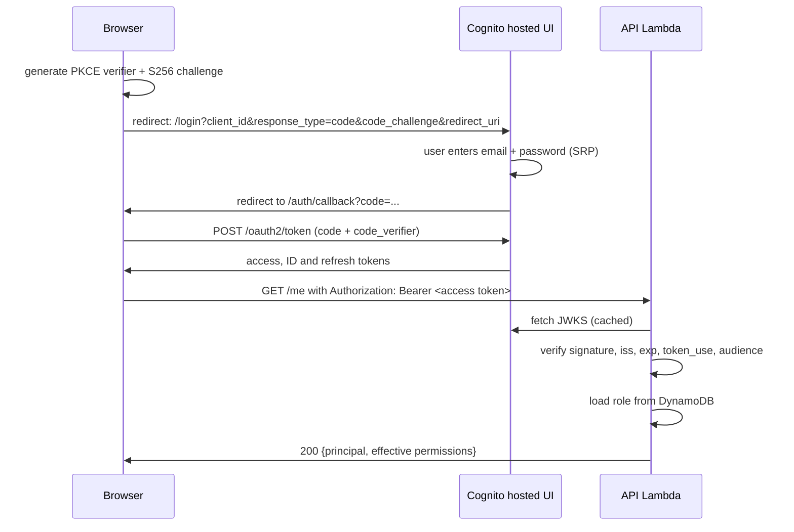

# Cognito — Complete Guide

**The other highest-priority topic.** Everything about authentication in
LifeLink, verified against the live user pool.

---

## 1. What Cognito is and why it exists

**Simple version.** Cognito handles sign-up, sign-in and user identity so you
do not have to store passwords yourself.

**Why that matters.** Storing passwords correctly is genuinely hard: you need
the right hashing algorithm with the right cost factor, a safe reset flow that
does not leak whether an account exists, rate limiting against brute force,
MFA, token issuance and expiry, and the discipline never to log any of it.
Every one of those is a place to make a mistake that is invisible until it is
catastrophic.

**Mechanism.** Cognito runs a **user pool** — a user directory with its own
sign-in. On successful authentication it issues **JSON Web Tokens** that your
backend verifies cryptographically without calling Cognito.

**Why LifeLink uses it.** The project handles health-adjacent coordination
across institutions. Rolling our own authentication would be the single
riskiest decision available, and it is not the interesting part of the problem.

### Say this
> "We don't store passwords at all. Cognito does, and it issues us signed JWTs
> instead. Doing password storage properly means the right hashing with the
> right cost factor, a reset flow that doesn't leak whether an account exists,
> brute-force protection, MFA — and every one of those is a place to be subtly
> wrong in a way you don't notice until it matters. It isn't the interesting
> part of our problem, so we didn't build it."

---

## 2. User pool versus identity pool

**A classic exam question, because the names are confusingly similar.**

| | **User pool** | **Identity pool** (federated identities) |
|---|---|---|
| Purpose | authenticate users, issue **JWTs** | exchange a token for **temporary AWS credentials** |
| Gives you | an identity in *your application* | an identity in *AWS IAM* |
| Output | access, ID and refresh tokens | AWS access key, secret, session token |
| Used for | "is this a signed-in donor?" | "may this browser call `geo:GetMapTile` directly?" |
| LifeLink | `ap-southeast-2_Z91jyFm1d` — **used** | `ap-southeast-2:31685707-...` — **deployed, unused** |

**The distinction in one sentence:** a user pool tells *your application* who
someone is; an identity pool tells *AWS* who they are so they can call AWS
services directly from the browser.

**Our identity pool is honest dead weight.** ADR-0012 planned to let the
browser fetch Amazon Location map tiles using identity-pool credentials and the
`MapReaderRole`. ADR-0019 replaced that with OpenStreetMap, so nothing uses it.
It costs nothing and is left in place.

---

## 3. The deployed user pool

| Setting | Value |
|---|---|
| Pool id | `ap-southeast-2_Z91jyFm1d` |
| Name | `lifelink-dev` |
| Tier | **ESSENTIALS** |
| Sign-in | **email as username** |
| Auto-verified attributes | `email` |
| Custom attributes | **none** |
| Groups | **none** |
| MFA | **OPTIONAL** |
| Account recovery | verified email only |
| Lambda triggers | **none** |
| Deletion protection | **INACTIVE** |
| Hosted domain | `lifelink-dev-426150327442.auth.ap-southeast-2.amazoncognito.com` |
| Users | 11 |
| Self sign-up | allowed (`AllowAdminCreateUserOnly: false`) |

**Note the pool id prefix.** `ap-southeast-2_` is literally part of the id,
which is a neat way to show that Cognito is a **regional** service.

---

## 4. Password policy

| Requirement | Value |
|---|---|
| Minimum length | **12** |
| Uppercase | required |
| Lowercase | required |
| Numbers | required |
| **Symbols** | **required** |
| Temporary password validity | 3 days |

### The bug this caused, and the fix worth describing

Three places in the frontend said "at least 8 characters" and none mentioned a
symbol. Users who followed the on-screen rules were **rejected by Cognito**
with an unhelpful error.

The fix was not just correcting the text. It was:

1. One shared module, `frontend/src/auth/passwordPolicy.js`, with
   `MIN_LENGTH = 12` and an explicit `SYMBOLS` set.
2. **A test that reads `infrastructure/template.yaml`** and asserts the UI
   requirements match the deployed pool policy.

49 tests now cover it. **Live proof:** Cognito refuses `Password1` with
`InvalidPasswordException` — exactly the password the old frontend accepted.

**That second step is the interesting part**, because it fixes the *class* of
bug. The UI and the deployed policy can no longer drift apart silently, since
the test fails if they do.

---

## 5. The app client

| Setting | Value |
|---|---|
| Client id | `5hp4pm3ictvetfupddvl41pnf` |
| Name | `lifelink-dev-web` |
| **Client secret** | **none** |
| OAuth flows | **`code`** |
| OAuth scopes | `openid`, `email`, `profile` |
| Identity providers | `COGNITO` |
| Explicit auth flows | `ALLOW_USER_SRP_AUTH`, `ALLOW_REFRESH_TOKEN_AUTH`, `ALLOW_ADMIN_USER_PASSWORD_AUTH` |
| Access token validity | **1 hour** |
| ID token validity | **1 hour** |
| Refresh token validity | **30 days** |
| Token revocation | **enabled** |
| `PreventUserExistenceErrors` | **ENABLED** |
| Callback URL | `https://d324z37do52g8f.cloudfront.net/auth/callback` |
| Logout URL | `https://d324z37do52g8f.cloudfront.net/` |

### The three auth flows, and honesty about the third

| Flow | What it is | Used by |
|---|---|---|
| `USER_SRP_AUTH` | Secure Remote Password — the password never crosses the network | the hosted UI |
| `REFRESH_TOKEN_AUTH` | exchange a refresh token for new tokens | the frontend |
| **`ADMIN_USER_PASSWORD_AUTH`** | a backend authenticates a user with a raw password via an admin API | **test scripting only** |

**Be straight about the third one.** It is enabled because
`scripts/provision_demo_logins.py` and the live verification scripts need to
obtain real tokens for demo accounts non-interactively. The browser never uses
it. **In a production pool it should be disabled**, because it means a
compromised backend credential can authenticate as any user with a known
password.

---

## 6. The authentication flow, step by step



### The code, file by file

| Step | File | Function |
|---|---|---|
| Start sign-in | `frontend/src/auth/cognito.js` | `beginSignIn({returnTo})` |
| Handle the callback | `frontend/src/features/account/AuthCallbackPage.jsx` | calls `completeSignIn()` |
| Exchange the code | `frontend/src/auth/cognito.js` | `completeSignIn(search)` |
| Store the session | `frontend/src/auth/cognito.js` | `saveSession`, `TOKEN_KEY = 'lifelink.session'` |
| Provide the token | `frontend/src/auth/AuthContext.jsx` | registers `setTokenProvider` |
| Attach the header | `frontend/src/api/client.js` | `request()` |
| Verify the token | `backend/src/appcore/auth.py` | `CognitoTokenVerifier.verify` |
| Authorize | `backend/src/appcore/auth.py` | `@requires(...)` |

### Why PKCE

The app client is **public** — its id necessarily ships in the JavaScript, and
it has no secret. So what stops someone who intercepts the authorization code
from exchanging it for tokens?

**PKCE (Proof Key for Code Exchange):**

1. The browser generates a random **verifier** and keeps it.
2. It sends only `SHA256(verifier)` — the **challenge** — when starting login.
3. Cognito stores the challenge against the code it issues.
4. When exchanging the code, the browser presents the **original verifier**.
5. Cognito hashes it and compares.

An intercepted code is useless, because the attacker does not have the
verifier and cannot derive it from the challenge.

### Say this
> "The app client is public — it has no secret, because a browser can't keep
> one; anyone can read the JavaScript. So we use Authorization Code with PKCE.
> The browser generates a random verifier, sends only its SHA-256 hash when it
> starts the login, and presents the original verifier when it exchanges the
> code. Cognito hashes it and compares. That means even if someone intercepted
> the authorization code from the redirect URL, it's useless to them — they
> don't have the verifier, and they can't work backwards from the hash."

---

## 7. The three tokens

| Token | Purpose | Key claims | Validity |
|---|---|---|---|
| **Access** | authorize API calls | `sub`, **`client_id`**, `scope`, `token_use: "access"`, `exp`, `iss` | 1 h |
| **ID** | describe the user | `sub`, **`aud`**, `email`, `token_use: "id"`, `exp`, `iss` | 1 h |
| **Refresh** | obtain new tokens | opaque — **not a JWT** | 30 d |

**LifeLink sends the access token.** It is the one meant for authorizing API
calls.

### The critical difference, and the bug it caused

> **A Cognito access token carries `client_id` and has NO `aud` claim.
> A Cognito ID token carries `aud` and has NO `client_id`.**

Code that checks only one field silently fails to validate the other token
type. The deployed fix:

```python
presented = claims.get("client_id") if token_use == "access" else claims.get("aud")
allowed = presented if isinstance(presented, (list, tuple)) else [presented]
if self.client_id not in allowed:
    raise UnauthenticatedError("token was not issued for this client")
```

**Honest limitation:** the exact attack this closes — a validly pool-signed ID
token issued for a *different* app client — cannot be demonstrated, because the
pool has exactly one app client. That is also why the flaw was never
exploitable here. It is proven by unit test instead: reverting the fix fails 3
of the 23 tests in `backend/tests/unit/test_cognito_token_verifier.py`.

**Say the limitation out loud.** Claiming you demonstrated an attack you could
not construct is the kind of thing one follow-up question destroys.

---

## 8. What the backend verifies

`backend/src/appcore/auth.py`, on **every** request:

| Check | How | Why |
|---|---|---|
| **Signature** | RS256 against the pool's JWKS public keys | proves Cognito issued it and it was not altered |
| **Issuer** (`iss`) | matches `https://cognito-idp.ap-southeast-2.amazonaws.com/ap-southeast-2_Z91jyFm1d` | rejects a token from another pool |
| **Expiry** (`exp`) | compared to now | rejects a stale token |
| **`token_use`** | `access` or `id` as expected | stops an ID token being used where an access token belongs |
| **Audience** | `client_id` or `aud`, per token type | rejects a token issued for a different app client |

**JWKS keys are cached** by `PyJWKClient`, so there is **not** a network call
to Cognito per request. That is worth saying, because the obvious objection to
"we verify every token" is "doesn't that mean calling Cognito constantly?"

### Why RS256 and not HS256

RS256 is **asymmetric**: Cognito signs with a private key it never shares, and
we verify with the public key from the JWKS endpoint. We can verify but cannot
forge.

HS256 is symmetric — the same secret signs and verifies — so every service that
validates tokens could also mint them. Asymmetric signing means a compromised
API server cannot issue valid tokens.

**And this is why `cryptography` must be an arm64 Linux wheel in the Lambda
package:** RS256 verification needs it. Building on Windows with `sam build`
would install a Windows binary that cannot load on the function — which is
exactly why `scripts/build_lambda_package.py` exists.

---

## 9. Roles are NOT in the token

**The most important design point in this document.**

| | |
|---|---|
| Cognito groups | **none** |
| Custom attributes | **none** |
| Where roles live | the `lifelink-dev-organizations` DynamoDB table |
| When they are read | **every request** |

### Why

1. **Immediate revocation.** A group baked into a one-hour token stays
   effective for up to an hour. A role read from the database is revoked on the
   **next request**.
2. **Organization scoping.** A role is not global — a blood bank admin has
   authority over *their* facility. That is a role plus an organization id plus
   a relationship: a record, not a flag.
3. **Account status.** Suspension must take effect immediately. Verified live:
   a suspended account with a freshly issued, perfectly valid token receives
   **403 `ACCOUNT_SUSPENDED`**.

**Cost:** one extra DynamoDB read per request — a few milliseconds.

### Say this
> "There are no Cognito groups and no custom attributes in our pool. All
> authorization data lives in DynamoDB and is read on every single request.
>
> That's deliberate. If a role were a claim in the token, revoking someone's
> access would take up to an hour, because that's the token lifetime. Reading it
> from the database means a revoked role applies on the very next request — and
> we verified that: a suspended account holding a valid token gets a 403 saying
> the account is suspended, not a 401.
>
> It also handles something a flat group can't express. A blood bank admin isn't
> an admin in general — they have authority over their own facility. That's a
> role plus an organization, which is a record, not a flag."

---

## 10. What happens when a token expires

1. The access token's `exp` passes.
2. The next API call returns **401 `UNAUTHENTICATED`**.
3. `ApiError.isAuthError` is true.
4. The frontend clears the stored session and redirects to sign-in.
5. If the refresh token is still valid (30 days), `refreshSession()` can obtain
   new tokens without re-entering a password.

> **A real bug here, worth telling.** The expiry branch in `AuthContext.jsx`
> called `localStorage.removeItem(STORAGE_KEY)` — but the constant is
> `TOKEN_KEY`; `STORAGE_KEY` did not exist. The resulting `ReferenceError` was
> swallowed by an empty `catch`, so **expired sessions were never cleared** and
> the user was stranded in a broken half-signed-in state. The fix routed it
> through `clearSession()`, and `no-empty` with `allowEmptyCatch: false` is now
> an ESLint error so an empty catch cannot hide a programming mistake again.

---

## 11. Console demonstration

```
Cognito -> User pools -> lifelink-dev (ap-southeast-2_Z91jyFm1d)
```

| Where | What to show |
|---|---|
| **Users** tab | 11 users, all CONFIRMED |
| **Groups** tab | **empty** — "our roles are in DynamoDB, not here" |
| **Sign-in** / Authentication | password policy: 12 characters, symbol required |
| **App clients** -> `lifelink-dev-web` | no secret, `code` flow, 1-hour tokens, `PreventUserExistenceErrors` on |
| **App integration** -> Domain | the hosted UI domain |
| Attributes | only `sub` and `email` — no `custom:` attributes |

### Safe to inspect, never to change

| Safe | **Never during an evaluation** |
|---|---|
| viewing users, policy, app client settings, domain | creating or deleting a user |
| | resetting a password |
| | changing the password policy |
| | editing callback URLs — **this breaks sign-in immediately**, because Cognito requires an exact match |
| | disabling a user |

> **Privacy:** two of the 11 users are real personal email addresses. **Do not
> read them aloud or screenshot the user list.** Demo accounts use
> `@demo.lifelink.invalid` — `.invalid` is a reserved TLD that can never
> resolve, so demo addresses cannot accidentally reach a real person.

---

## 12. Live demonstrations you can actually run

### Unauthenticated request is rejected
```bash
curl -s -o /dev/null -w "%{http_code}\n" \
  https://uk6itz2a5b.execute-api.ap-southeast-2.amazonaws.com/dev/me
# 401
```

### A public route still works
```bash
curl -s https://uk6itz2a5b.execute-api.ap-southeast-2.amazonaws.com/dev/health
# {"data":{"status":"ok",...},"correlationId":"corr-..."}
```

Both verified on 24 November 2026.

### A garbage token is rejected
```bash
curl -s -o /dev/null -w "%{http_code}\n" -H "Authorization: Bearer not.a.token" \
  https://uk6itz2a5b.execute-api.ap-southeast-2.amazonaws.com/dev/me
# 401
```

### Inspect a token's claims — **safely**

Paste a token into a decoder only if you understand that **you are handing it
to a website**. The safe alternative is to decode it locally:

```bash
# Decode the payload of a JWT without sending it anywhere
echo "<token>" | cut -d. -f2 | base64 -d 2>/dev/null | python -m json.tool
```

Point out `token_use`, `client_id` (access) or `aud` (ID), `exp` and `sub`.

**Never paste a real token into jwt.io or any online decoder during a
demonstration, and never into a document or slide.** A live access token is a
credential for a full hour.

---

## 13. Spoken answers

### "How does authentication work in LifeLink?" — 30 seconds
> "We use a Cognito user pool. The browser redirects to Cognito's hosted login,
> the user signs in there, and Cognito returns an authorization code which the
> app exchanges for JWTs using PKCE. Every API call then carries the access
> token as a Bearer header, and our Lambda verifies the signature against
> Cognito's public keys. We never see or store a password."

### 1–2 minutes
> "Three parts: the pool, the flow, and verification.
>
> The pool holds the users, with a policy of twelve characters including a
> symbol. There's exactly one app client, and it's public — no secret, because a
> browser can't keep one.
>
> The flow is Authorization Code with PKCE. The browser generates a random
> verifier, sends its hash to start the login, and presents the original when
> exchanging the code. An intercepted code is useless without the verifier.
>
> Verification happens in our Lambda on every request. We check the RS256
> signature against the pool's public keys, the issuer, the expiry, the
> `token_use`, and the audience. The audience check is where we found a real
> bug: Cognito puts the audience in `client_id` on an access token and in `aud`
> on an ID token — different claims — so checking only one meant the other token
> type wasn't properly validated. We fixed it per token type, and reverting the
> fix fails three unit tests.
>
> The thing I'd emphasise is what's *not* in the token: roles. Our pool has no
> groups and no custom attributes. We read the user's role from DynamoDB on
> every request, so revoking access takes effect on the next request instead of
> up to an hour later."

---

## 14. Follow-up questions

**"Can someone modify a JWT?"**
> They can change the bytes, but not without breaking the signature. The token
> is signed with RS256 — Cognito's private key, which we never have — and we
> verify with the public key from the JWKS endpoint. Any alteration fails
> verification. We tested that specifically: a token with a rewritten `aud`
> claim is rejected with 401.

**"What if another app client issued a token?"**
> It would be rejected. We compare the audience against our configured client
> id. That's the fix described above, and it's per token type because Cognito
> uses different claims. Honestly, though — I can't demonstrate the attack,
> because our pool has only one app client, so no such token can be produced.
> That's also why the weakness was never exploitable. It's proven by unit test.

**"Why not just validate the token at API Gateway with a Cognito authorizer?"**
> Because it only solves a third of the problem. An authorizer checks the
> signature, but our authorization also needs the user's role from DynamoDB and
> their account status, and it has to apply organization scoping. We'd still
> need the Lambda to do all that, so the logic would be split across two places.
> Keeping all five checks in one decorator means one reviewable place and a test
> that enumerates every route to prove none is unprotected.

**"What stops someone brute-forcing a password?"**
> Cognito rate-limits authentication attempts itself, and
> `PreventUserExistenceErrors` means a wrong password and an unknown email
> return the same error, so an attacker can't even enumerate which addresses
> are valid. The policy of twelve characters with mixed classes makes guessing
> impractical. What we do **not** have is required MFA — it's optional, which in
> practice means off for most users. For institutional roles I'd make it
> mandatory in production.

**"Where is the user's role stored, exactly?"**
> In the `lifelink-dev-organizations` table, alongside their organization and
> account status. I can show you the record in the DynamoDB console, and I can
> show `GET /me` returning the principal with their effective permissions
> computed from it.

---

## 15. Cross-references

- [../08_SECURITY_AND_RELIABILITY/01_Cognito_Authentication_Flow.md](../08_SECURITY_AND_RELIABILITY/01_Cognito_Authentication_Flow.md)
- [../08_SECURITY_AND_RELIABILITY/03_JWT_And_Token_Verification.md](../08_SECURITY_AND_RELIABILITY/03_JWT_And_Token_Verification.md)
- [../09_PRACTICAL_AWS_DEMONSTRATIONS/05_Showing_Cognito_In_Action.md](../09_PRACTICAL_AWS_DEMONSTRATIONS/05_Showing_Cognito_In_Action.md)
- [08_IAM_Complete_Guide.md](08_IAM_Complete_Guide.md)
- [../09_PRACTICAL_AWS_DEMONSTRATIONS/CONFIGURATION_WALKTHROUGHS.md](../09_PRACTICAL_AWS_DEMONSTRATIONS/CONFIGURATION_WALKTHROUGHS.md) §D
