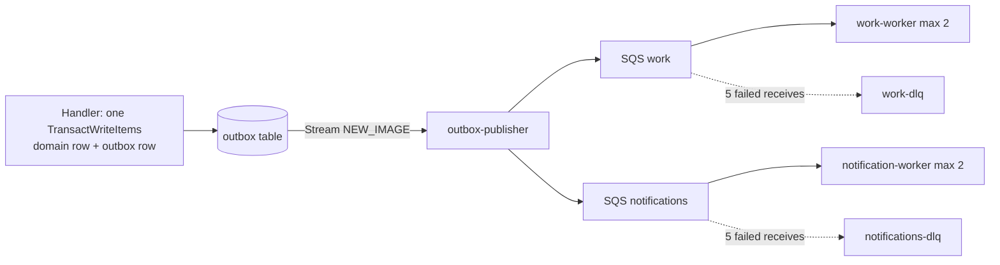

# SQS, SNS and Notifications

Four queues, one topic, and an honest account of what the notification
pipeline does and does not do.

---

## 1. SQS versus SNS — the comparison teachers ask for

| | **SQS** (queue) | **SNS** (topic) |
|---|---|---|
| Pattern | **point to point** | **publish / subscribe** |
| Consumers | one message, one consumer | one message, **every** subscriber |
| Delivery | **pull** — consumers poll | **push** — SNS calls the subscriber |
| Storage | messages persist (up to 14 days) | **no storage** — delivered or retried, then gone |
| Analogy | an in-tray | a mailing list |
| Ordering | best-effort (FIFO queues available) | none |
| In LifeLink | 4 queues for work and notifications | 1 topic for CloudWatch alarms |

**The key difference to state:** SQS stores a message until someone processes
it; SNS fans a message out to all subscribers immediately and does not keep it.
That is why work goes in a queue — the work must happen even if the consumer is
briefly down — and alarms go to a topic, where delivery to several recipients
at once is the point.

**The common pattern they are sometimes asked about:** SNS **fan-out to SQS** —
publish once to a topic, with several queues subscribed, giving both fan-out
and durability. LifeLink does not use it, because our fan-out happens in the
outbox publisher Lambda, which writes directly to the right queue based on the
event type.

---

## 2. The four queues

| Queue | Role |
|---|---|
| `lifelink-dev-work` | deferred application work |
| `lifelink-dev-work-dlq` | its dead-letter queue |
| `lifelink-dev-notifications` | notification composition |
| `lifelink-dev-notifications-dlq` | its dead-letter queue |

| Setting | Main queues | DLQs |
|---|---|---|
| Visibility timeout | **180 s** | 30 s |
| Message retention | **4 days** | **14 days** |
| Delay | 0 | 0 |
| Receive wait time | 0 (short polling) | 0 |
| Max message size | 1 MB | 1 MB |
| **Encryption** | **SSE-SQS** | **SSE-SQS** |
| Redrive | `maxReceiveCount: 5` -> DLQ | — |
| Messages now | **0** | **0** |

### The three settings worth explaining

**Visibility timeout 180 s against a 29 s function.** When a consumer receives
a message it becomes invisible to other consumers for this long. If it expired
before the function finished, the message would become visible again and be
processed **twice concurrently**. 180 s is over six times the function timeout
— deliberately generous, because the failure mode of being too short is
duplicate concurrent processing, which is much worse than a delay.

**DLQ retention 14 days versus 4.** A dead-letter queue exists for a human to
investigate. Four days could expire over a long weekend; fourteen is the
maximum SQS allows.

**`maxReceiveCount: 5`.** Enough retries to ride out a transient failure — a
throttle, a brief DynamoDB blip — and few enough that a genuinely broken
message reaches the DLQ promptly rather than retrying indefinitely.

**Say this:**
> "The setting I'd point at is the visibility timeout: 180 seconds against a
> 29-second function timeout. When a consumer picks up a message it's hidden
> from other consumers for that long. If it expired before the function
> finished, the message would reappear and be processed twice at the same time —
> so we made it over six times the function timeout. Being too generous just
> delays a retry; being too short causes concurrent duplicate processing."

---

## 3. How a message gets into a queue — the transactional outbox



**Why not send to SQS directly from the handler?** Because "write to DynamoDB,
then send to SQS" has two failure modes:

1. The write commits and the send fails -> **the event is lost**.
2. The send succeeds and the write rolls back -> **an event for something that
   never happened**.

Writing the event into the **same transaction** as the data makes both
impossible. The DynamoDB Stream then delivers it at least once.

**The consequence:** delivery is **at-least-once**, so consumers must be
idempotent. That is what the `idempotency` table and its conditional put are
for (ADR-0009).

**The outbox table is empty (0 rows) right now, and that is correct** — rows
are written, consumed, and expire by TTL. A permanently non-empty outbox would
mean the publisher was failing.

---

## 4. The consumers

| Consumer | Source | Batch | Window | Max concurrency |
|---|---|---|---|---|
| `work-worker` | SQS `work` | 5 | 10 s | **2** |
| `notification-worker` | SQS `notifications` | 5 | 10 s | **2** |

**`MaximumConcurrency: 2` is the critical setting.** The account's total Lambda
concurrency is **10**. Without this cap, a backlog of queue messages would
scale consumers up and consume the whole pool, leaving nothing for the API —
the user-facing path would fail because of background work.

**Batch of 5 with a 10-second window:** collect up to 5 messages, or wait up to
10 seconds, whichever comes first. Batching reduces invocation count; the
window bounds latency when traffic is sparse.

**`ReportBatchItemFailures`** is enabled on both, so the function returns which
records failed and the successful ones in a batch are not reprocessed.

---

## 5. SNS — and the gap

| | |
|---|---|
| Topic | `lifelink-dev-alarms` |
| Display name | "LifeLink operational alarms" |
| **Subscriptions confirmed** | **0** |
| Subscriptions pending | 0 |
| Encryption | not configured |
| Publishers | all **8** CloudWatch alarms |

**All eight alarms publish to a topic with no subscribers. Nothing notifies
anyone.**

**Why it happened:** the template creates the topic and wires the alarms to it,
but a subscription needs an **endpoint** — an email address or phone number —
which is personal data that should not be committed to a template in a
repository. So it was left as a manual step, and never done.

**What still works:** the alarms genuinely evaluate, change state, and keep a
history you can see in the Console. What is missing is only **delivery**.

**The fix (not applied — engineering freeze):** add an email subscription and
confirm it, or pass the address as a stack parameter.

### Say this — volunteering it is far stronger than being caught
> "Here's a real gap. We have eight CloudWatch alarms and they all publish to an
> SNS topic — but the topic has zero subscriptions, so nothing actually reaches
> a person. The alarms do work: they evaluate, they change state, and you can
> see their history. What's missing is delivery.
>
> It happened because a subscription needs an endpoint like an email address,
> and I didn't want personal data committed to the template, so it became a
> manual step that never got done. It's a one-minute fix, and it's a good
> reminder that an alarm nobody is subscribed to is monitoring theatre."

---

## 6. Notifications — what actually happens

**Be precise here, because it is easy to overclaim.**

| Channel | Status | Evidence |
|---|---|---|
| **In-app notifications** | **works** | 18 rows in `lifelink-dev-notifications`; `GET /me/notifications` serves them |
| Notification preferences | works | `GET`/`PUT /me/notification-preferences` |
| **Email** | **`NOT-IMPLEMENTED` as deployed** | the seam exists; `SES_SENDER` is **empty** |
| **SMS** | **`NOT-IMPLEMENTED`** | ADR-0015, and blocked by the account's SCP |
| Push | `NOT-IMPLEMENTED` | never designed |

**The decisive evidence:** `lifelink-dev-notification-worker` has **no
CloudWatch log group at all**, which means it has **never been invoked**.
Notification records are written directly to the table by the services that
create them; the worker exists for composition and delivery and has not run.

### Say this
> "Notifications are in-app only. When something happens that a user should know
> about, we write a record to the notifications table and they see it in the
> app — there are eighteen of those right now.
>
> Email is wired but not configured: the sender address environment variable is
> empty, so nothing sends. SMS isn't implemented at all — that's ADR-0015, and
> it's also blocked by our account's service control policy.
>
> I can show you the strongest evidence for that: the notification worker Lambda
> has no CloudWatch log group, which means it has literally never been invoked.
> I'd rather tell you that than imply the pipeline runs end to end."

---

## 7. Failure scenarios

| Failure | What happens |
|---|---|
| Consumer throws | message returns to the queue, retried, DLQ after 5 receives |
| Consumer times out | same — visibility expires and it is redelivered |
| Poison message | reaches the DLQ after 5 attempts; alarm `*-dlq-not-empty` fires |
| Queue backlog grows | alarm `lifelink-dev-work-queue-age` at >300 s for 2 periods |
| Lambda throttled | message stays queued; processed when capacity frees |
| Stream has a bad record | **bisect on error** isolates it; on-failure destination is `work-dlq` |
| Message duplicated | consumers are idempotent via the `idempotency` table |
| **Alarm fires** | **nothing reaches a human** — see §5 |

**The pattern to notice:** the asynchronous path degrades gracefully — nothing
is lost, work is simply delayed. That is exactly why deferrable work was moved
off the request path.

---

## 8. Console demonstration

```
SQS -> Queues -> filter "lifelink"        (4 queues)
  lifelink-dev-work -> Details
     visibility timeout 180s, retention 4 days, SSE-SQS
     Dead-letter queue section -> work-dlq, maxReceiveCount 5
  Monitoring tab -> messages received, deleted, age of oldest
```

```
SNS -> Topics -> lifelink-dev-alarms
  Subscriptions tab  -> EMPTY       <- show this honestly
```

```
CloudWatch -> Alarms -> filter "lifelink"   (8 alarms, all OK)
  lifelink-dev-work-dlq-not-empty -> Actions -> publishes to the SNS topic
```

**The honest demonstration sequence:** show the alarm, show that its action
publishes to the topic, then show the topic has no subscriptions. Explaining
your own gap is more impressive than hiding it.

**Do not** use "Send and receive messages" to inject a test message, and do
not purge a queue.

---

## 9. Spoken answers

### 20–30 seconds
> "We use SQS for background work — two queues, each with a dead-letter queue.
> Work gets onto a queue through a transactional outbox: the handler writes the
> data and the event in one DynamoDB transaction, a stream picks it up, and a
> publisher Lambda puts it on the right queue. SNS is used only for CloudWatch
> alarm notifications. The difference is that SQS stores a message until someone
> processes it, while SNS fans out immediately and keeps nothing."

### 1–2 minutes
> "The interesting part is how a message gets into a queue. The naive approach
> is to write to the database and then send to SQS, but that has two failure
> modes: the write succeeds and the send fails, so you lose the event; or the
> send succeeds and the write rolls back, so you've published an event for
> something that never happened.
>
> So we use a transactional outbox. The handler writes the domain record and an
> outbox row in a single DynamoDB transaction — both commit or neither does. A
> DynamoDB Stream on the outbox table triggers a publisher Lambda that fans the
> event out to the right queue. That makes both failure modes impossible. The
> cost is that delivery is at-least-once, so our consumers have to be
> idempotent, which is what the idempotency table handles.
>
> Both consumers are capped at two concurrent executions, because we only have
> ten in the whole account — without that cap, a queue backlog would scale the
> workers up and starve the API."

---

## 10. Follow-up questions

**"Why not SNS fan-out to SQS?"**
> It's a good pattern and we could have used it. Our fan-out logic lives in the
> outbox publisher Lambda, which decides which queue an event belongs on based
> on its type. SNS-to-SQS would move that routing into subscription filter
> policies. The reason we kept it in code is that the publisher already exists
> to consume the DynamoDB stream, so adding SNS in the middle would be another
> service for the same result.

**"How do you know a message wasn't lost?"**
> Three things. The event is written in the same transaction as the data, so it
> can't be lost at creation. The stream and queue both guarantee at-least-once
> delivery. And anything the consumer genuinely can't process lands in the
> dead-letter queue rather than disappearing, with an alarm on the DLQ becoming
> non-empty. What I can't currently claim is that anyone would be *told* —
> because the alarm topic has no subscribers.

**"What happens to a message if the consumer is broken for a week?"**
> It's lost. Main queue retention is four days, so after that messages expire.
> A broken consumer would move messages to the DLQ after five attempts, and the
> DLQ keeps them fourteen days — so in practice the DLQ is what buys you the
> week, not the main queue.

**"Why short polling rather than long polling?"**
> `ReceiveMessageWaitTimeSeconds` is 0, which is short polling. With a Lambda
> event source mapping it matters much less, because Lambda manages the polling
> for us and uses long polling internally. Setting it on the queue would be
> meaningful if we were polling from our own consumer code.

---

## 11. Cross-references

- [05_AWS_Lambda.md](05_AWS_Lambda.md) — event source mappings
- [10_EventBridge_And_Step_Functions.md](10_EventBridge_And_Step_Functions.md)
- [11_CloudWatch.md](11_CloudWatch.md) — the alarms
- [../08_SECURITY_AND_RELIABILITY/05_Error_Handling_And_Retries.md](../08_SECURITY_AND_RELIABILITY/05_Error_Handling_And_Retries.md)
- [../09_PRACTICAL_AWS_DEMONSTRATIONS/CONFIGURATION_WALKTHROUGHS.md](../09_PRACTICAL_AWS_DEMONSTRATIONS/CONFIGURATION_WALKTHROUGHS.md) §G
