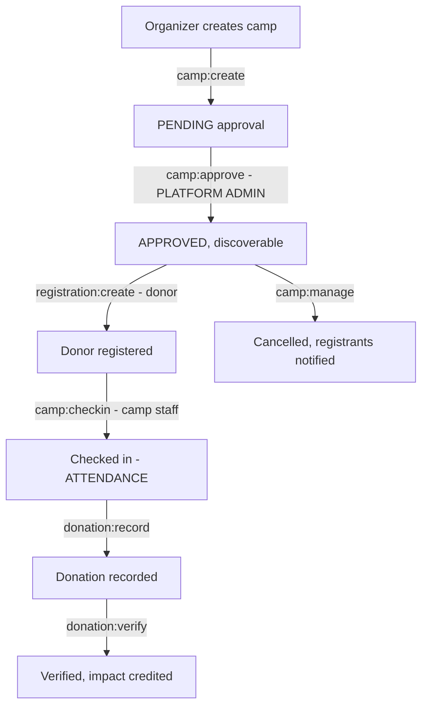

# Feature 3 — Donation Camps and Donor Engagement

The supply side: organizers run camps, donors register and donate, and
donations become recognised impact.

---

## 1. Objective

Blood supply comes from donors. This feature covers the whole chain: an
organizer creating a camp, a platform admin approving it, donors finding and
registering, staff checking them in, donations being recorded and verified, and
the donor seeing what their donation achieved.

---

## 2. The lifecycle, and who may act at each step



**Note the separation of duties at two points:**

| Step | Who **cannot** do it |
|---|---|
| Approving a camp | the **organizer** — `camp:approve` is platform-admin only |
| Verifying a donation | — but `donation:record` and `donation:verify` are separate permissions |

**You cannot approve your own camp.** That is a deliberate separation of
duties, and a good detail to point out.

---

## 3. The honesty rule in this feature

> **Registrations are never called attendance.**

```javascript
// frontend/src/components/mapData.js
/** One line summarising a camp. Registrations are never called attendance. */
export function campSummary(camp) {
  ...
  bits.push(`${registered}/${capacity} registered`)
```

**Why it matters.** A camp with 80 registrations may see 30 people. Reporting
registrations as attendance would overstate supply, and an organizer planning
staff and equipment on that number would be misled.

So there are **three distinct facts**, never conflated:

| Fact | Means |
|---|---|
| **Registered** | someone said they would come |
| **Checked in** | someone actually arrived (`camp:checkin`) |
| **Donated** | someone actually donated (`donation:record`) |

**Say this:**
> "We're careful never to call registrations attendance. A camp with eighty
> registrations might see thirty people turn up, and an organizer planning staff
> and equipment on the wrong number would be misled. So registered, checked in
> and donated are three separate facts with three separate permissions — and the
> UI always says 'registered' when it means registered."

---

## 4. Donor engagement — impact, not gamification

`backend/src/domain/impact.py` computes an impact score and milestones from
**verified** donations.

**The design restraint worth noting:** impact is credited only from a
**verified** donation (`donation:verify`), not from a recorded one. A recorded
donation is a claim; a verified one has been checked. The same
*updated-is-not-verified* discipline as inventory.

Donor-facing endpoints:

| Method | Path | Shows |
|---|---|---|
| GET | `/me/donor-profile` | impact score and milestones |
| GET | `/me/donations` | donation history |
| GET | `/me/donations/{id}/certificate` | a recognition certificate |
| GET | `/me/registrations` | my camp registrations |

**On the certificate:** it is recognition for a verified donation, not a
medical document. It names what was donated and when, and makes no clinical
claim.

---

## 5. Eligibility

`backend/src/domain/eligibility.py` holds donor eligibility rules — primarily
the interval since a previous donation.

**An important boundary to state:** the system records and advises; it does not
make a medical determination. Final eligibility is decided by clinical staff at
the camp. The rule exists so the UI does not invite someone to register for a
camp they plainly cannot donate at, which wastes their trip.

---

## 6. The API — 16 endpoints

| Method | Path | Permission | Anon |
|---|---|---|---|
| GET | `/camps` | `camp:read` | **yes** |
| GET | `/camps/{id}` | `camp:read` | **yes** |
| POST | `/camps` | `camp:create` | no |
| GET | `/camps/mine` | `camp:manage` | no |
| POST | `/camps/{id}/approve` | **`camp:approve`** | no |
| POST | `/camps/{id}/cancel` | `camp:manage` | no |
| POST | `/camps/{id}/staff` | `camp:staff:assign` | no |
| POST | `/camps/{id}/register` | `registration:create` | no |
| DELETE | `/camps/{id}/register` | `registration:manage:own` | no |
| POST | `/camps/{id}/checkin` | `camp:checkin` | no |
| POST | `/camps/{id}/donations` | `donation:record` | no |
| POST | `/camps/{id}/donations/verify` | **`donation:verify`** | no |
| GET | `/me/registrations` | `registration:manage:own` | no |
| GET | `/me/donations` | `registration:manage:own` | no |
| GET | `/me/donations/{id}/certificate` | `registration:manage:own` | no |
| GET | `/me/donor-profile` | `registration:manage:own` | no |

**Camp search and detail are anonymous-allowed**, so someone can find a camp
without creating an account. Registering requires one.

**`POST /camps/{id}/register` uses the idempotency key `reg-<campId>`** — note
it has **no timestamp**, so it is stable. Registering for the same camp twice
is idempotent *by the key's design*, not merely within a retry window.

---

## 7. Data

| Table | Rows | Indexes |
|---|---|---|
| `lifelink-dev-camps` | **46** | `GSI1-geo`, `GSI2-user`, `GSI3-organizer`, `GSI4-reminder` |
| `lifelink-dev-donations` | **14** | `GSI1-camp` |

**`GSI4-reminder` exists for the scheduled sweep** — the maintenance Lambda uses
it to find camps needing reminder notifications.

**`GSI1-geo` is a single geohash tier**, unlike facilities' three, because camp
searches use a narrower range of radii. Verified live: a camp search near
Patiala returned **6 camps** with `effectiveRadiusKm: 20`.

---

## 8. Code locations

| Concern | File |
|---|---|
| Camp lifecycle and capacity | `backend/src/domain/camps.py` |
| Donor eligibility | `backend/src/domain/eligibility.py` |
| Impact and milestones | `backend/src/domain/impact.py` |
| Orchestration | `backend/src/services/camp_service.py` |
| DynamoDB | `backend/src/repositories/camp_repo.py` |
| Camp search | `frontend/src/features/camps/CampsPage.jsx` |
| Camp detail and registration | `frontend/src/features/camps/CampDetailPage.jsx` |
| Organizer dashboard | `frontend/src/features/dashboards/CampOrganizerDashboard.jsx` |
| Donor dashboard | `frontend/src/features/dashboards/DonorDashboard.jsx` |
| Camp dashboard tab | `frontend/src/features/dashboards/CampDashboardTab.jsx` |
| Camp summary text | `frontend/src/components/mapData.js` -> `campSummary` |

Tests: `backend/tests/unit/test_camps_and_impact.py`,
`backend/tests/integration/test_camp_discovery_radius.py`,
`backend/tests/integration/test_camp_reminders.py`.

---

## 9. Error and edge cases

| Case | Behaviour |
|---|---|
| Camp full | registration refused; UI shows "full" |
| Registering twice | idempotent via `reg-<campId>` |
| Cancelling a camp | registrants notified (in-app) |
| Organizer approving own camp | **403** — `camp:approve` not held |
| Donor not eligible | advised; clinical staff decide finally |
| Checking in someone not registered | validation error |
| Verifying an unrecorded donation | validation error |
| Camp in the past | not returned by search |

---

## 10. Status

| Aspect | Status |
|---|---|
| Camp CRUD, approval, cancellation | `DEPLOYED`, `TEST-VERIFIED` |
| Registration and capacity | `DEPLOYED`, `TEST-VERIFIED` |
| Check-in, donation recording, verification | `DEPLOYED`, `TEST-VERIFIED` |
| Impact scoring | `TEST-VERIFIED` |
| Camp radius search | **verified live** — 6 camps, radius 20 km |
| Anonymous camp search | **verified live** (200) |
| Camp reminders | **`TEST-VERIFIED` only** — the notification worker has **never been invoked**, and email is unconfigured |
| **Browser workflow by a person** | **NOT VERIFIED** |

**Be precise about reminders.** The logic exists and is tested; the delivery
mechanism has not run. Say "the reminder logic is tested but no reminder has
ever actually been delivered, because email isn't configured."

---

## 11. Spoken answers

### 20–30 seconds
> "Organizers create camps and a platform admin approves them — you can't
> approve your own. Donors find camps near them, register, and at the camp staff
> check them in and record donations, which are then verified and credited to the
> donor's impact score. We're careful to keep registered, checked in and donated
> as three separate facts, because a camp with eighty registrations might see
> thirty people."

### 1–2 minutes
> "The chain is: an organizer creates a camp, a platform admin approves it, it
> becomes discoverable, donors register, staff check them in on the day, record
> the donation, and then verify it — and only a verified donation credits the
> donor's impact score.
>
> Two design points I'd highlight. First, separation of duties: `camp:approve`
> is a platform-admin permission, so an organizer can't approve their own camp.
> And recording a donation and verifying it are separate permissions, so a
> volunteer can record without being able to credit impact.
>
> Second, we're disciplined about language. Registrations are never called
> attendance. A camp with eighty registrations might see thirty people turn up,
> and an organizer planning staff and equipment on the wrong number would be
> misled. So registered, checked in and donated are three distinct facts with
> three distinct permissions, and the UI always says what it means.
>
> One honest limitation: the camp reminder logic is tested, but no reminder has
> ever actually been delivered, because email isn't configured — the sender
> address is empty and the notification worker Lambda has never been invoked."

---

## 12. Follow-up questions

**"How do you stop someone registering twice?"**
> The idempotency key for registration is `reg-<campId>` with no timestamp in
> it, so it's stable across attempts. The backend does a conditional put into
> the idempotency table, so the second attempt fails the condition and returns
> the original result. That's stronger than deduplicating within a retry window
> — it's idempotent by the key's design.

**"Why does a camp need approval at all?"**
> Because an unapproved camp appearing in search would let anyone advertise a
> blood donation event, which is a safety and trust problem. The organizer
> creates it; a platform admin reviews it. It's the same reason organizations
> themselves go through verification before they can act.

**"Is the impact score gamification?"**
> It's recognition rather than gamification — milestones for verified donations
> and a certificate. We deliberately credited only *verified* donations, not
> recorded ones, so the number can't be inflated by someone recording donations
> that didn't happen. It's the same updated-versus-verified discipline we use for
> inventory.

**"Does the system decide if someone can donate?"**
> No, and that boundary is deliberate. We hold eligibility rules — mostly the
> interval since a previous donation — and use them so the UI doesn't invite
> someone to register for a camp they plainly can't donate at, which would waste
> their trip. The final determination is made by clinical staff at the camp. We
> advise; we don't diagnose.

---

## 13. Cross-references

- [../07_MAPS_AND_INTEGRATIONS/03_Distance_And_Haversine.md](../07_MAPS_AND_INTEGRATIONS/03_Distance_And_Haversine.md)
- [06_Authentication_And_User_Workflows.md](06_Authentication_And_User_Workflows.md)
- [../01_START_HERE/03_Project_Features_And_User_Roles.md](../01_START_HERE/03_Project_Features_And_User_Roles.md)
- [../04_AWS_COMPLETE_GUIDE/09_SNS_SQS_And_Notifications.md](../04_AWS_COMPLETE_GUIDE/09_SNS_SQS_And_Notifications.md)
