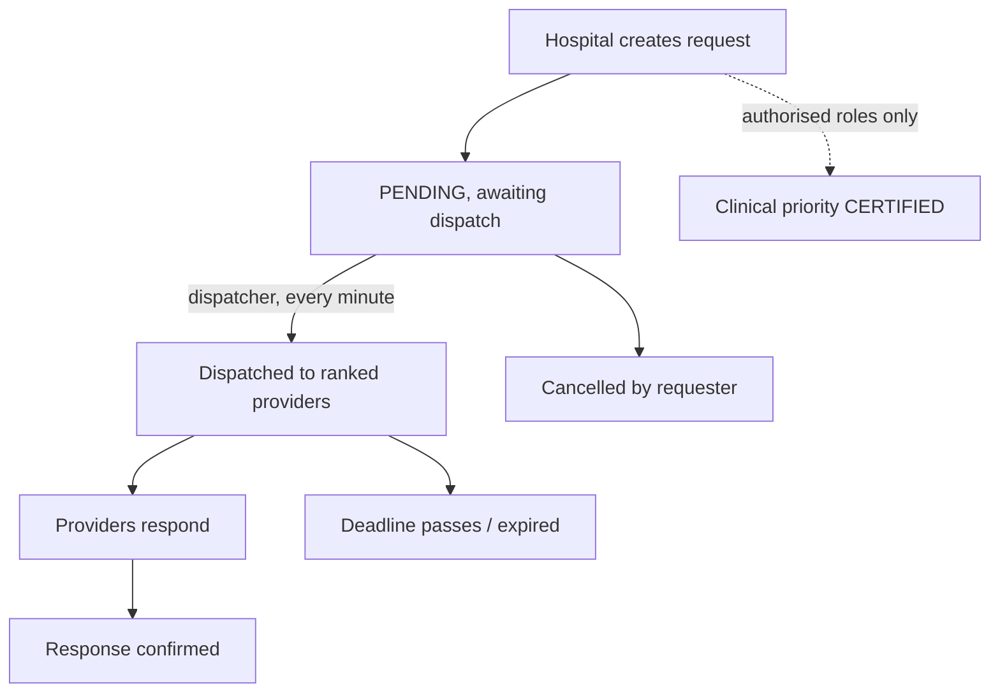

# Feature 4 — Smart Emergency Coordination

The urgent path: a hospital raises a request, and the system asks candidate
providers in a sensible order.

**This is a separate workflow from temporary reservations. Keep them
distinct.**

---

## 1. Objective

When a hospital needs blood urgently, replace "phone blood banks one at a
time" with one request that reaches several ranked providers at once, and track
every response.

### How it differs from a reservation

| | Reservation (ADR-0018) | Emergency request |
|---|---|---|
| Shape | a **hold on one facility's units** | a **broadcast to many providers** |
| Holds units? | **yes**, via a counter | **no** |
| Who decides | one blood bank | several, independently |
| Urgency | ordinary | **deadline-driven** |
| Clinical priority | n/a | **can be certified** |

**Say this if asked why there are two workflows:**
> "They're different shapes. A reservation is a hold on specific units at one
> facility — it holds them so nobody else can. An emergency request is a
> broadcast: it goes to several candidate providers ranked by suitability, and
> each responds independently. It deliberately doesn't hold units, because you
> can't hold stock at six blood banks at once on the chance one of them
> delivers."

---

## 2. The lifecycle



---

## 3. The dispatcher — every minute

`lifelink-dev-dispatcher`, `handlers.workers.dispatcher_handler`, triggered by
**EventBridge Scheduler** at `rate(1 minute)`.

What it does:

1. Query `GSI1-dispatch` for requests awaiting dispatch.
2. Rank candidate providers with `domain/ranking.py` — distance, availability,
   data freshness.
3. Record a dispatch **event** per provider.
4. Queue notifications.

### Why every minute

**This is the emergency path.** A request with a deadline cannot wait ten
minutes to reach providers. One minute is the shortest `rate()` interval
available.

`FlexibleTimeWindow` is **OFF** — deliberately spreading the invocation within
a window would add latency to the one job whose purpose is reducing it.

### Why a poll rather than invoking on creation

**A good question with a good answer.**

> "Because a request also becomes dispatchable through *time*, not just through
> creation — a deadline approaching, a provider failing to respond, a previous
> dispatch expiring. A poll handles creation and all the time-driven
> transitions with one mechanism. If we invoked on creation only, we'd need a
> second mechanism for everything else."

### Why not three SQS priority queues

**ADR-0006.** Because ranking needs to consider distance, availability and data
freshness **together**, and a queue's ordering cannot express that. A queue
orders by **arrival**; a ranked dispatcher orders by **suitability**.

### Its IAM role is the best least-privilege example in the project

| Table | Actions |
|---|---|
| `emergency`, `notifications` | **full** read/write |
| `inventory`, `facilities`, `organizations` | **read only** |

**The dispatcher reads stock levels to rank providers and physically cannot
modify stock** — not because the code does not try, but because the permission
does not exist.

---

## 4. "Dispatch order is not clinical priority"

**One of the five honesty rules, and the one with the most ethical weight.**

| | |
|---|---|
| What the ranking decides | **who gets asked first** |
| What it never decides | **who deserves blood** |

Ranking inputs are logistical: distance, whether the provider appears to have
stock, and how recently their data was updated. It is a **convenience**, not a
triage decision.

Clinical priority is **certified by a human**, recorded with who certified it,
and the system never infers it.

**Say this if asked about the ethics of ranking:**
> "The ranking decides who we ask first, based on distance, apparent
> availability and how fresh their data is. It never decides who deserves blood
> — that's a medical judgement. We make that distinction explicit in the code
> and the documentation, because an algorithm that quietly ordered patients by
> some computed priority would be exactly the wrong thing to build. Clinical
> priority can be *certified*, but only by an authorised human, and we record
> who did it."

---

## 5. Certification — the most restricted permission

`POST /emergency-requests/{id}/certify` requires
**`emergency:certify:priority`**, held by only **3 of 10** roles:

- `HOSPITAL_AUTHORIZER`
- `HOSPITAL_ADMIN`
- `PLATFORM_ADMIN`

**Verified live:** a donor attempting to certify receives **403**. A donor
attempting to read the provider queue also receives **403**.

**Why a separate role rather than just "hospital staff":** so a hospital can
let many staff raise requests while only a few may attest to urgency. The
permission split follows **trust**, not seniority.

---

## 6. The data model — three entity types, one table

`lifelink-dev-emergency`, **59 rows**:

| `entityType` | Count |
|---|---|
| `REQUEST_EVENT` | **35** (10 seeded + 25 genuine) |
| `EMERGENCY_REQUEST` | **11** |
| `PROVIDER_RESPONSE` | **13** |

Keys — **the clearest parent/child example in the database:**

| Entity | PK | SK |
|---|---|---|
| Request | `REQUEST#<id>` | `META` |
| Event | `REQUEST#<id>` | `EVENT#<iso>#<uuid8>` |
| Response | `REQUEST#<id>` | `RESPONSE#<orgId>` |

**One `Query` on `PK` returns the request, its entire timeline and every
provider response, already sorted.** No joins.

Four indexes:

| GSI | Answers |
|---|---|
| `GSI1-dispatch` | requests awaiting dispatch — the dispatcher's query |
| `GSI2-requester` | my organization's requests |
| `GSI3-provider` | requests awaiting my response |
| `GSI4-deadline` | requests by deadline |

---

## 7. Events are append-only — deliberately

```python
# backend/src/repositories/emergency_repo.py
"SK": f"EVENT#{to_iso(now)}#{event_id}"   # event_id = uuid4()[:8]
```

**This was deliberately left unchanged** when the seeder's key was made
deterministic. Real history must **accumulate**; a deterministic key would mean
a second genuine event overwrote the first.

| Writer | Key | Behaviour | Correct because |
|---|---|---|---|
| `emergency_repo.append_event` | timestamp + uuid | **appends** | real history accumulates |
| `seed_demo.seed_event_sk` | `EVENT#0000#seed0001` | **overwrites** | re-seeding must be idempotent |

**Two writers, two opposite correct behaviours.** That is the lesson.

### §1.20 — the odd timeline, and why it is not fixed

Re-seeding revives demo requests into dispatchable states, so the live
dispatcher appends **genuine** events with real current timestamps while the
seeded creation event refreshes. A timeline can read **"created 24 Nov, expired
16 Nov"**.

**Why it must not be "fixed":**

- Those events are **real application history** — deleting them means deleting
  genuine records.
- Sorting by `occurredAt` instead of sort key would be **worse**: you would see
  a request created *after* its own expiry.

**If a teacher spots it:**
> "Good catch, and the explanation is more interesting than a bug. Re-seeding
> puts demo requests back into dispatchable states, so the dispatcher — which
> runs every minute — writes genuine events with real timestamps, while the
> seeded creation event gets the new run's timestamp. So the ordering looks
> wrong.
>
> We deliberately didn't fix it, because those dispatcher events are real
> history and deleting them would mean deleting genuine records. And sorting by
> occurrence time would be worse — you'd see a request created after it expired.
> The real fix is a dataset change, seeding requests in terminal states, and
> that would cost us the dispatch and expiry scenarios we want to demonstrate."

---

## 8. The API — 8 endpoints

| Method | Path | Permission |
|---|---|---|
| POST | `/emergency-requests` | `emergency:create` |
| GET | `/emergency-requests` | `emergency:read:own` |
| GET | `/emergency-requests/{id}` | `emergency:read:own` |
| POST | `/emergency-requests/{id}/cancel` | `emergency:cancel` |
| POST | `/emergency-requests/{id}/certify` | **`emergency:certify:priority`** |
| POST | `/emergency-requests/{id}/confirm` | `emergency:certify:priority` |
| POST | `/emergency-requests/{id}/respond` | `emergency:respond` |
| GET | `/emergency-requests/provider-queue` | `emergency:respond` |

**Note:** `POST /emergency-requests` accepts a caller-supplied
**`Idempotency-Key`**, so a retried creation under network uncertainty cannot
produce two requests for the same emergency.

---

## 9. Code locations

| Concern | File |
|---|---|
| Lifecycle rules | `backend/src/domain/emergency.py` |
| Provider ranking | `backend/src/domain/ranking.py` |
| Orchestration | `backend/src/services/emergency_service.py` |
| DynamoDB + `append_event` | `backend/src/repositories/emergency_repo.py` |
| Dispatcher worker | `backend/src/handlers/workers.py` -> `dispatcher_handler` |
| Request form | `frontend/src/features/emergency/EmergencyRequestPage.jsx` |
| Tracking timeline | `frontend/src/features/emergency/RequestTrackingPage.jsx` |
| Hospital dashboard | `frontend/src/features/dashboards/HospitalDashboard.jsx` |
| Label on the button | `frontend/src/components/RequestBloodButton.jsx` — **"Emergency request"** |

---

## 10. Status

| Aspect | Status |
|---|---|
| Request creation, cancellation | `DEPLOYED`, `TEST-VERIFIED` |
| Dispatcher | **`DEPLOYED` and demonstrably running** — log streams every minute |
| Ranking | `TEST-VERIFIED` |
| Provider responses | `DEPLOYED`, 13 rows exist |
| Certification restricted | **verified live** (donor -> 403) |
| Provider queue restricted | **verified live** (donor -> 403) |
| Organization isolation | **verified live** (403 for another org's request) |
| Notifications | in-app only; email unconfigured, SMS not implemented |
| **Browser workflow by a person** | **NOT VERIFIED** |
| Timeline ordering | **§1.20** — cosmetic, documented |

**The dispatcher's log group is the best proof it runs:** about 8 MB
accumulated, with log streams appearing roughly every minute.

---

## 11. Spoken answers

### 20–30 seconds
> "A hospital raises an urgent request. A Lambda function runs every minute,
> finds requests awaiting dispatch, ranks candidate blood banks by distance,
> apparent availability and how fresh their data is, and records a dispatch to
> each one. Providers respond through their own queue, and a response can be
> confirmed. Clinical priority can be certified separately, but only by
> authorised hospital roles."

### 1–2 minutes
> "It's deliberately a different workflow from reservations. A reservation holds
> specific units at one facility. An emergency request is a broadcast to several
> ranked providers, and it doesn't hold units — you can't hold stock at six
> blood banks on the chance one delivers.
>
> The dispatcher runs every minute on EventBridge Scheduler. We chose a poll
> rather than invoking it when a request is created, because a request also
> becomes dispatchable through time — a deadline approaching, a provider not
> responding, a previous dispatch expiring. One mechanism handles all of it.
>
> The thing I'd emphasise is a distinction we make explicit: dispatch order is
> not clinical priority. The ranking decides who we ask first, using distance,
> apparent stock and data freshness. It never decides who deserves blood.
> Clinical priority is certified by a human, we record who certified it, and
> only three of our ten roles can do it — we verified live that a donor
> attempting to certify gets a 403.
>
> The dispatcher's IAM role is also my favourite least-privilege example: it has
> read-only permissions on the inventory table. It reads stock to rank providers
> and physically cannot modify it."

---

## 12. Follow-up questions

**"How many providers does it dispatch to?"**
> A ranked shortlist rather than everyone, so a request doesn't spam every blood
> bank in Punjab. The ranking is by distance, apparent availability and data
> freshness together — which is exactly why this is an application-level
> dispatcher rather than SQS priority queues. A queue orders by arrival; we need
> to order by suitability.

**"What if the dispatcher fails?"**
> There's an alarm, `lifelink-dev-dispatcher-failure`, that fires on a single
> error — because it runs unattended, so any error is unexpected. EventBridge
> Scheduler also retries. Honestly though: the alarm publishes to an SNS topic
> with no subscriptions, and the schedule has no dead-letter queue, so a
> sustained failure would be detected and not reported. That's the weakest part
> of our operational setup.

**"Can a hospital see another hospital's requests?"**
> No. `emergency:read:own` plus the organization scoping check in the
> authorisation decorator. We verified it live — a request for another
> organization returns 403. That actually caught us out during verification: a
> probe script reported "0 entries" for a request and it looked like a data bug,
> when it was a 403 and the isolation was working correctly. The script was
> reading `.data` on an error response.

**"Why can the same permission confirm and certify?"**
> `confirm_availability` and `certify_priority` both require
> `emergency:certify:priority`. Confirming a provider's availability on behalf
> of the request is an act of the same authority as attesting to urgency — both
> are the requesting hospital committing to the request. If they needed to
> diverge, that's a one-line change and a new permission.

---

## 13. Cross-references

- [05_Temporary_Reservations.md](05_Temporary_Reservations.md) — the distinct workflow
- [../04_AWS_COMPLETE_GUIDE/10_EventBridge_And_Step_Functions.md](../04_AWS_COMPLETE_GUIDE/10_EventBridge_And_Step_Functions.md)
- [../04_AWS_COMPLETE_GUIDE/08_IAM_Complete_Guide.md](../04_AWS_COMPLETE_GUIDE/08_IAM_Complete_Guide.md)
- [../05_DATABASE_AND_DATA/03_Synthetic_Data_Generation.md](../05_DATABASE_AND_DATA/03_Synthetic_Data_Generation.md) §5–6
- `docs/KNOWN_LIMITATIONS.md` §1.20
