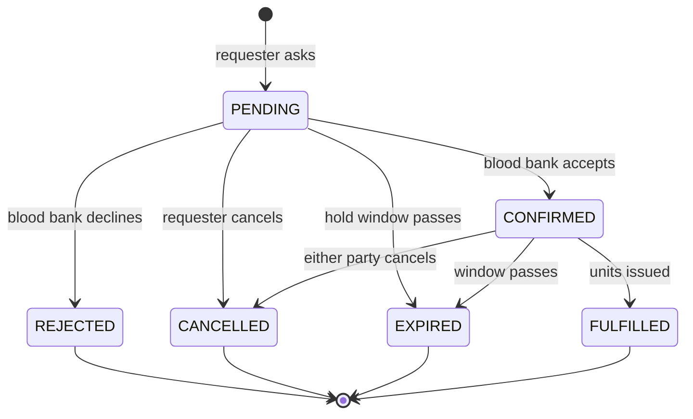

# Temporary Reservations

**Read this before any other feature document.** Reservations are not a side
feature — per **ADR-0018** they **are** the ordinary blood request workflow.

---

## 1. The architectural decision, stated correctly

> **There is no separate "ordinary blood request" entity in LifeLink. A request
> for units in the non-emergency path *is* a temporary reservation.**

If asked to describe a `BloodRequest` table, **correct the premise**. It does
not exist, and its absence is deliberate.

### Why

A "request" that does not hold units is an **expression of interest**. Two
hospitals can both be told yes for the same units, and one of them will arrive
to nothing.

A **reservation** holds the units with a counter, so the system cannot
oversell. The honesty rule is explicit: **an offer is not a reservation.**

### Say this if asked "where is your blood request feature?"
> "Ordinary requests are implemented as temporary reservations — that's
> ADR-0018. A request that doesn't hold anything can be granted twice, so
> instead of a separate request entity we hold the units with a counter and a
> countdown, and the blood bank accepts, rejects, or lets it expire. Emergency
> coordination is deliberately a separate workflow, because an emergency is a
> broadcast to many providers rather than a hold on one."

**Emergency coordination stays distinct.** See
[04_Smart_Emergency_Coordination.md](04_Smart_Emergency_Coordination.md).

---

## 2. The lifecycle



**Units are held in `PENDING` and `CONFIRMED`** — those are the `HOLDING_STATES`.
Every other state holds nothing.

---

## 3. The data model

Two row types in `lifelink-dev-reservations`:

| Type | Purpose |
|---|---|
| `RESERVATION` | one request, with status and expiry |
| `RESERVATION_POOL` | per facility + blood group + component, carrying **`heldUnits`** |

**Current live state:** 9 reservations + 5 pools = 14 rows.

| Status | Count |
|---|---|
| `CANCELLED` | 6 |
| `FULFILLED` | 1 |
| `EXPIRED` | 1 |
| `CONFIRMED` | 1 (**stale — §1.15**) |

**All 5 pools have `heldUnits = 0`.** Nothing is currently held — the healthy
state, and the first thing to check if asked about counter consistency.

### Why a counter rather than counting the rows

Counting reservations would need a `Query` and a sum, which is **not atomic** —
two concurrent requests could both count the same stale total. A single counter
updated inside a conditional transaction is atomic by construction.

---

## 4. The transactional write

```
TransactWriteItems:
  Put    reservation row    ConditionExpression: attribute_not_exists(PK)
  Update pool heldUnits     ConditionExpression: heldUnits + :units <= availableUnits
```

**All-or-nothing.** If either condition fails, neither write happens.

**The concurrent case:**

```
Hospital A and B both request the last 2 units
Transaction A: 0 + 2 <= 2  -> COMMITS, heldUnits = 2
Transaction B: 2 + 2 >  2  -> ROLLS BACK entirely
```

Hospital B receives **`NO_UNRESERVED_STOCK`**. **Verified live.**

---

## 5. The defect — the most valuable story in the project

The transaction design was right. The logic deciding *when* to release held
units was not.

```python
# backend/src/services/reservation_service.py — the deployed fix
releases = (
    reservation.status in HOLDING_STATES
    and updated.status not in HOLDING_STATES
)
```

**The original had only the first clause** — it asked *"was this reservation
holding units?"* rather than *"does it stop holding units?"*

| Transition | Was holding? | Stops holding? | Original | Correct |
|---|---|---|---|---|
| `PENDING` -> `CONFIRMED` | yes | **no** | **released — WRONG** | hold |
| `CONFIRMED` -> `FULFILLED` | yes | yes | released | released |
| `PENDING` -> `CANCELLED` | yes | yes | released | released |

**The consequence:** confirming a reservation **released its own hold**. The
units became available to someone else while the reservation still claimed
them — permitting overselling — and the confirmed hold could then be neither
cancelled nor fulfilled correctly.

### How it was found and proven

| | |
|---|---|
| Found by | the **first live run** of `confirm -> cancel` |
| Tests passing at the time | **over 900** |
| Regression tests added | **6; four failed against the old code** |
| Live re-verification | all three paths, counters read **directly from DynamoDB** |

| Path | `heldUnits` sequence |
|---|---|
| `PENDING -> CONFIRMED -> FULFILLED` | 0 -> 2 -> 2 -> 0 |
| `PENDING -> CONFIRMED -> CANCELLED` | 0 -> 2 -> 2 -> 0 |
| `PENDING -> CANCELLED` | 0 -> 2 -> 0 |

`heldUnits` matched the API's `reservedUnits` at **all ten checkpoints**.

**Reading the counter straight from DynamoDB rather than through the API
mattered** — otherwise we would have been trusting the thing under test.

Full post-mortem: `docs/RESERVATION_COUNTER_DEFECT.md`.

---

## 6. The API

| Method | Path | Permission | Who |
|---|---|---|---|
| POST | `/facilities/{id}/reservations` | `reservation:create` | requester |
| GET | `/me/reservations` | `reservation:manage:own` | requester |
| DELETE | `/facilities/{id}/reservations/{rid}` | `reservation:manage:own` | requester |
| GET | `/facilities/{id}/reservations` | **`reservation:manage`** | blood bank |
| POST | `/facilities/{id}/reservations/{rid}/decision` | `reservation:manage` | blood bank |
| POST | `/facilities/{id}/reservations/{rid}/fulfil` | `reservation:manage` | blood bank |

**The `:own` versus bare distinction is the authorisation model in miniature:**
`reservation:manage:own` is the requester cancelling their own hold; plain
`reservation:manage` is the blood bank deciding on holds against its facility.
Both are further constrained by the organization scoping check.

**Verified live:** a blood bank admin on **their own** facility's queue gets
**200**; the same admin on **another** facility's queue gets **403**.

---

## 7. The frontend

| File | Role |
|---|---|
| `features/discovery/ReservationPanel.jsx` | the **requester's** form |
| `features/reservations/ReservationQueue.jsx` | the **facility's** screen (22 tests) |
| `features/reservations/reservationView.js` | **pure logic**, 43 tests, no React |
| `features/reservations/reservationStatus.js` | lifecycle states mirroring the backend |
| `features/account/MyActivityPage.jsx` | the requester's list (18 tests) |

### `reservationView.js` — the decisions extracted from the component

| Function | Decides |
|---|---|
| `remainingMs`, `formatRemaining` | the countdown |
| `holdsUnits` | whether this reservation currently holds units |
| `isStaleHold` | a hold whose time has passed but whose status has not |
| `statusLabel` | **"Accepted — units held"**, never "approved" |
| `facilityActions` | which buttons the blood bank may press |
| `canRequesterCancel` | whether the requester may cancel |
| `partitionForFacility` / `partitionForRequester` | grouping, **differing by viewer** |
| `totalHeldUnits` | the dashboard sum |

**Why extract all this?** Because these are the decisions with consequences —
whether a button appears, whether units are described as held. Testing them
through a rendered component would be slow and indirect; 43 fast tests cover
them directly.

### Language discipline

**`statusLabel` says "Accepted — units held", never "approved".** Approval
implies a clinical or managerial judgement the system does not make. A blood
bank accepting a hold is an operational act.

### `isStaleHold` — why the UI does not trust stored status

There is one real row with status `CONFIRMED` whose hold window has passed
(§1.15). `isStaleHold()` compares the clock to the status, so the UI shows it
as expired.

**That design choice is why the maintenance sweep running every ten minutes
rather than every second is safe** — effective status is computed, not stored.

### Placement on the dashboard

`ReservationQueue` sits **above** the batch forms on `BloodBankDashboard`,
because a pending hold is time-critical and stock editing is not.

---

## 8. Expiry

| Mechanism | Role |
|---|---|
| `maintenance` Lambda, every 10 min | moves lapsed holds to `EXPIRED` and releases units |
| `GSI2-expiry` | the query that finds them |
| `isStaleHold()` in the UI | shows effective status immediately, without waiting |
| TTL on **`purgeAtEpoch`** | deletes the row **much later** |

**Why TTL uses `purgeAtEpoch` and not `expiresAtEpoch`:** a reservation has a
**business expiry** (the hold runs out) and a **storage purge** far later.
Using one attribute for both would delete the record at the moment the user
most wants to see that their hold expired.

**A small naming decision carrying a real user-experience consequence** — worth
mentioning.

---

## 9. Error cases

| Case | Code | Status |
|---|---|---|
| Units already held | `NO_UNRESERVED_STOCK` | 409 |
| Facility has no such stock | `VALIDATION_ERROR` | 400 |
| Not your reservation | `FORBIDDEN` | 403 |
| Another facility's queue | cross-organization | 403 |
| Already in a terminal state | `VALIDATION_ERROR` | 400 |
| Concurrent modification | `CONCURRENT_MODIFICATION` | 409, **retryable** |

---

## 10. Status

| Aspect | Status |
|---|---|
| Backend logic | `DEPLOYED`, `TEST-VERIFIED` |
| All three transitions | **verified live**, counters from DynamoDB |
| Overselling prevention | **verified live** |
| Organization isolation | **verified live** (403) |
| Frontend queue screen | `DEPLOYED`, 22 component tests |
| Pure view logic | 43 tests |
| **Browser workflow by a person** | **NOT VERIFIED** |
| One stale `CONFIRMED` row | §1.15 — holds nothing |

---

## 11. Spoken answers

### 20–30 seconds
> "Temporary reservations are how ordinary blood requests work — there's no
> separate request entity, which is ADR-0018. A requester asks for specific
> units, that creates a hold with a countdown, and the blood bank accepts,
> rejects or lets it expire. Units are tracked by a counter on a pool row, and
> the reservation and the counter are written in one DynamoDB transaction, so
> two hospitals can't reserve the same units."

### 1–2 minutes
> "The design decision is that a request and a reservation are the same thing. A
> request that doesn't hold units is just an expression of interest — two
> hospitals could both be told yes for the same units, and one arrives to
> nothing. So instead we hold them: a pool row per facility, blood group and
> component carries a counter of held units, and creating a reservation updates
> both the reservation row and that counter in a single transaction, conditioned
> on there still being enough unreserved units.
>
> And then the honest part. The transaction design was correct, but the logic
> deciding when to *release* held units was wrong. It asked 'was this
> reservation holding units' instead of 'does it stop holding units' — and both
> are true when you confirm a pending hold. So confirming a reservation released
> its own units, which allows overselling blood.
>
> Over nine hundred tests were passing. We found it on the first live run of
> confirm-then-cancel. We added six regression tests, four of which fail against
> the old code, and then verified all three transition paths against the
> deployed system with the counters read directly out of DynamoDB rather than
> through our own API — because otherwise we'd be trusting the thing we were
> testing."

---

## 12. Follow-up questions

**"What stops a blood bank accepting more than it has?"**
> The condition on the transaction: `heldUnits` plus the requested units must
> not exceed available units. It's evaluated by DynamoDB at write time, so it
> can't be raced. And we verified it live — the second requester against a
> fully-held pool got `NO_UNRESERVED_STOCK`.

**"How long is a hold?"**
> A configured window, after which the maintenance job moves it to `EXPIRED`
> and releases the units. The UI doesn't wait for that, though — it computes
> effective status from the clock with `isStaleHold`, so a lapsed hold displays
> as expired immediately even if the sweep hasn't run. That's why running the
> sweep every ten minutes rather than every second is safe.

**"Why 'accepted' rather than 'approved'?"**
> Because approval implies a clinical or managerial judgement, and a blood bank
> accepting a hold is an operational act. It's the same discipline as 'an offer
> is not a reservation' — we try not to let the UI imply authority the system
> doesn't have.

**"What's the stale CONFIRMED row?"**
> One reservation left over from before the counter fix. Its status says
> confirmed but its hold window has passed, so its effective status is expired,
> and it holds nothing — every pool counter is zero. We didn't settle it because
> that means hand-editing production data, which can't be reproduced by
> re-seeding. It's documented as known limitation 1.15, and the UI already shows
> it correctly as expired.

---

## 13. Cross-references

- [../05_DATABASE_AND_DATA/06_Concurrency_And_Data_Integrity.md](../05_DATABASE_AND_DATA/06_Concurrency_And_Data_Integrity.md)
- [04_Smart_Emergency_Coordination.md](04_Smart_Emergency_Coordination.md) — the distinct workflow
- [02_Find_Blood_And_Location.md](02_Find_Blood_And_Location.md)
- [../02_SYSTEM_ARCHITECTURE/02_End_To_End_Data_Flow.md](../02_SYSTEM_ARCHITECTURE/02_End_To_End_Data_Flow.md)
- `docs/RESERVATION_COUNTER_DEFECT.md`, `docs/ARCHITECTURE_DECISIONS.md` ADR-0018
