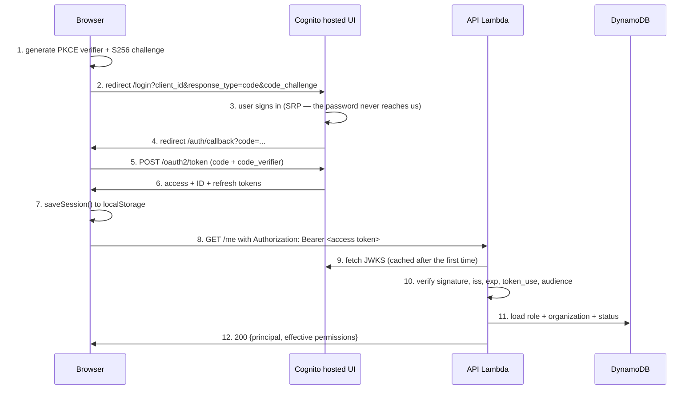

# Cognito Authentication Flow

The complete sign-in journey, step by step, with the file that handles each
step.

---

## 1. The flow



---

## 2. Step by step, with files

| Step | File | Function |
|---|---|---|
| 1–2 | `frontend/src/auth/cognito.js` | `beginSignIn({returnTo})` |
| 3 | — | Cognito's hosted UI |
| 4 | `frontend/src/features/account/AuthCallbackPage.jsx` | handles the redirect |
| 5–6 | `frontend/src/auth/cognito.js` | `completeSignIn(search)` |
| 7 | `frontend/src/auth/cognito.js` | `saveSession`, `TOKEN_KEY = 'lifelink.session'` |
| 8 | `frontend/src/auth/AuthContext.jsx` -> `frontend/src/api/client.js` | `setTokenProvider`, `request()` |
| 9–10 | `backend/src/appcore/auth.py` | `CognitoTokenVerifier.verify` |
| 11–12 | `backend/src/appcore/auth.py` | `@requires(...)` |

---

## 3. Why the hosted UI rather than our own login form

| | Hosted UI | Our own form |
|---|---|---|
| Who sees the password | **only Cognito** | our JavaScript |
| Brute-force protection | Cognito's | we build it |
| MFA | built in | we build it |
| Password reset flow | built in | we build it |
| Risk if our site has an XSS flaw | password **never present** to steal | password in our DOM |

**That last row is the strongest argument.** With the hosted UI, an XSS
vulnerability on our site cannot capture a password, because the password is
never typed into our page.

**Say this:**
> "We redirect to Cognito's hosted login rather than building our own form.
> The decisive reason is that the password is never typed into our page at all —
> so even if our site had a cross-site scripting flaw, there's no password there
> to steal. We also get brute-force protection, MFA and password reset without
> writing them. The cost is a redirect away from our domain, which is slightly
> less polished."

---

## 4. PKCE — in detail

### The problem it solves

The app client is **public** — no secret, because a browser cannot keep one;
anyone can read the JavaScript. So what stops an attacker who intercepts the
authorization code from exchanging it for tokens?

### The mechanism

```
1. Browser generates a random  verifier   (kept, never sent)
2. Browser computes            challenge = SHA256(verifier)
3. Browser sends               challenge  with the login request
4. Cognito stores the challenge against the code it issues
5. Browser sends               verifier   when exchanging the code
6. Cognito computes SHA256(verifier) and compares
```

**An intercepted code is useless**, because the attacker does not have the
verifier and cannot derive it from the challenge — SHA-256 is one-way.

### Why the code appears in a URL at all

The authorization code arrives as a **query parameter** on the redirect, which
means it can land in browser history, a referrer header, or a server log. PKCE
is precisely the mitigation for that exposure: the code alone is not enough.

**Say this:**
> "The app client is public — no secret, because a browser can't keep one. So we
> use PKCE. The browser generates a random verifier, sends only its SHA-256
> hash to start the login, and presents the original verifier when exchanging
> the code. Cognito hashes it and compares.
>
> That matters because the authorization code arrives as a query parameter in
> the redirect URL, so it can end up in browser history or a log. PKCE means
> that even if someone gets the code, it's useless without the verifier — and
> they can't work backwards from the hash."

---

## 5. SRP — why the password does not cross the network

Cognito's hosted UI uses **Secure Remote Password**, enabled on the app client
as `ALLOW_USER_SRP_AUTH`.

SRP is a password-authenticated key exchange: the client proves it knows the
password **without transmitting it**. Even Cognito's own servers do not receive
the password in the clear during sign-in.

**Also enabled, and worth being honest about:** `ALLOW_ADMIN_USER_PASSWORD_AUTH`,
used by `scripts/provision_demo_logins.py` and the live verification scripts to
obtain real tokens non-interactively. The browser never uses it. **In a
production pool it should be disabled**, because it means a compromised backend
credential could authenticate as any user with a known password.

---

## 6. The session in the browser

| | |
|---|---|
| Storage | `localStorage`, key `lifelink.session` |
| Access / ID token | 1 hour |
| Refresh token | 30 days |
| Refresh | `refreshSession(session)` |
| Expiry check | `isExpired(session, now)` — **pure**, so tests control the clock |
| Sign-out | `signOutRedirect()` — Cognito logout, and revocation is enabled |

### The token provider pattern

```javascript
setTokenProvider(() => currentSession?.accessToken ?? null)
```

The API client holds a **function**, not a token. So there is exactly **one**
copy of the session, and no component can hold a stale one.

### The real bug in the expiry path

> The expiry branch called `localStorage.removeItem(STORAGE_KEY)` — but the
> constant is `TOKEN_KEY`; `STORAGE_KEY` did not exist. The resulting
> `ReferenceError` was **swallowed by an empty `catch`**, so expired sessions
> were **never cleared** and the user was stranded in a broken half-signed-in
> state.
>
> **Found by:** enabling ESLint for the first time.
> **Fixed by:** routing through `clearSession()`.
> **Prevented by:** `no-empty` with `allowEmptyCatch: false` is now an
> **error**.

**The lesson generalises:** the failure was not the typo. It was that a
programming mistake could hide inside error handling.

### `localStorage` — the honest trade-off

| | `localStorage` (ours) | httpOnly cookie |
|---|---|---|
| Readable by JavaScript | **yes** — vulnerable to XSS | **no** |
| Sent automatically | no | yes — needs CSRF protection |
| Needs a backend session endpoint | no | yes |

**Do not defend `localStorage` as optimal.** Say it is the common choice, that
the exposure is XSS, and that the mitigation is a short one-hour token plus the
fact that the password is never in our page.

---

## 7. What happens after verification — the handover to authorization

Authentication answers *who are you*. The next four checks answer *what may you
do*, and they are covered in
[02_IAM_Authorization_Flow.md](02_IAM_Authorization_Flow.md).

| # | Check | Layer |
|---|---|---|
| **1** | **token verification** | **authentication** |
| 2 | load the user from DynamoDB | authorization |
| 3 | account status | authorization |
| 4 | permission | authorization |
| 5 | organization scoping | authorization |

**The ordering matters:** we establish identity before asking anything about
entitlement.

---

## 8. Failure modes

| Failure | Result | Where handled |
|---|---|---|
| Wrong password | generic error — `PreventUserExistenceErrors` prevents enumeration | Cognito |
| Unknown email | **the same** generic error | Cognito |
| Password too weak at sign-up | `InvalidPasswordException` | Cognito; the UI shows the real rules from `passwordPolicy.js` |
| `redirect_uri` mismatch | bare "redirect_uri mismatch" with **no detail** | Cognito — an exact string match is required; a trailing slash breaks it |
| Code exchanged twice | rejected | Cognito |
| Token expired | **401**, session cleared, redirect to sign-in | `auth.py` + `AuthContext` |
| Token from another pool | **401** — issuer mismatch | `auth.py` |
| Cognito unavailable | sign-in fails; **anonymous browsing still works** on the 9 public routes | — |

**`PreventUserExistenceErrors: ENABLED` is worth calling out.** Without it,
Cognito returns `UserNotFoundException` for an unknown email and
`NotAuthorizedException` for a wrong password — which lets an attacker
**enumerate valid email addresses**. With it, both return the same error.

---

## 9. Status

| Aspect | Status |
|---|---|
| PKCE flow implemented | `REPO`, `DEPLOYED` |
| Token verification | **verified live** — 19 checks |
| Password policy matches the pool | **verified live** — `Password1` refused |
| Suspended account refused | **verified live** — 403 |
| Expired session clearing | fixed, `DEPLOYED` |
| Callback URL configured | `DEPLOYED` — matches the CloudFront origin exactly |
| **Browser sign-in by a person** | **NOT VERIFIED** |

**If asked which of the 12 outstanding manual checks matters most: this one.**
Everything else depends on sign-in working in a real browser with a real
redirect.

---

## 10. Spoken answers

### 20–30 seconds
> "The browser redirects to Cognito's hosted login with a PKCE challenge. The
> user signs in there — the password never touches our code — and Cognito
> redirects back with an authorization code, which the app exchanges for tokens
> using the PKCE verifier. Every API call then carries the access token, and our
> Lambda verifies the signature against Cognito's public keys and loads the
> user's role from DynamoDB."

### 1–2 minutes
> "There are three parts worth explaining.
>
> First, we use Cognito's hosted UI rather than our own login form. The decisive
> reason is that the password is never typed into our page — so even if our site
> had an XSS flaw, there's no password there to steal. We also get brute-force
> protection, MFA and password reset for free.
>
> Second, PKCE. Our app client is public — no secret, because a browser can't
> keep one. The authorization code comes back as a query parameter in the
> redirect URL, so it can end up in browser history or a log. PKCE means the
> code alone isn't enough: the browser generated a random verifier, sent only
> its hash to start the login, and has to present the original to exchange the
> code.
>
> Third, what the backend does with the token. It verifies the RS256 signature
> against Cognito's cached public keys, the issuer, the expiry, the token type
> and the audience — and then it does something people don't expect: it loads
> the user's role from DynamoDB rather than reading it from the token. Our pool
> has no groups and no custom attributes at all. That costs one extra read per
> request and buys immediate revocation: we verified live that a suspended
> account holding a perfectly valid token gets a 403."

---

## 11. Cross-references

- [03_JWT_And_Token_Verification.md](03_JWT_And_Token_Verification.md)
- [02_IAM_Authorization_Flow.md](02_IAM_Authorization_Flow.md)
- [../04_AWS_COMPLETE_GUIDE/07_Cognito_Complete_Guide.md](../04_AWS_COMPLETE_GUIDE/07_Cognito_Complete_Guide.md)
- [../06_FEATURE_IMPLEMENTATION/06_Authentication_And_User_Workflows.md](../06_FEATURE_IMPLEMENTATION/06_Authentication_And_User_Workflows.md)
- [../09_PRACTICAL_AWS_DEMONSTRATIONS/05_Showing_Cognito_In_Action.md](../09_PRACTICAL_AWS_DEMONSTRATIONS/05_Showing_Cognito_In_Action.md)
