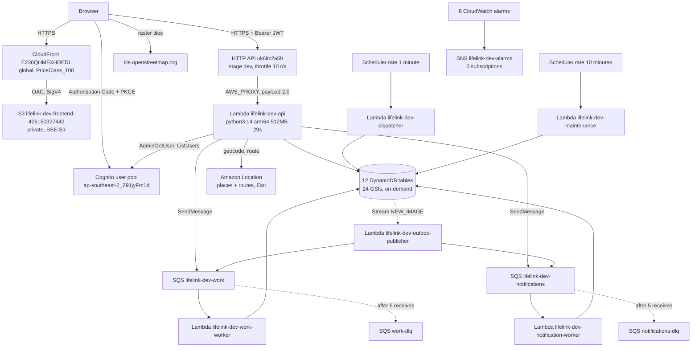

# AI_TEACHING_CONTEXT — complete briefing for an AI assistant teaching LifeLink

**Read this file before answering any question about LifeLink.** It is the
single most accurate summary of the project that exists. Everything in it was
verified against the live AWS environment, the infrastructure template, or the
source code on **24 November 2026**, at repository commit **`668a771`**.

**Who you are teaching.** A second-year Computer Engineering student who built
this project, plus teammates with little cloud knowledge. They have a
laboratory evaluation and a viva. They need to explain and demonstrate the
*actual* implementation, not a plausible-sounding version of it.

---

## 0. Warnings — the eight things that are easiest to get wrong

An AI assistant teaching this project will be tempted into each of these
errors. Every one of them has been checked.

| # | The tempting wrong answer | The verified truth |
|---|---|---|
| 1 | "It uses API Gateway REST API" | It is an **HTTP API** (`AWS::ApiGatewayV2::Api`, id `uk6itz2a5b`). Different service, different console page, cheaper, fewer features. |
| 2 | "API Gateway validates the JWT with a Cognito authorizer" | **There is no authorizer.** Both routes are `AuthorizationType: NONE`. The Lambda verifies every token itself in `backend/src/appcore/auth.py`. |
| 3 | "It uses Step Functions" | **Step Functions is not used at all.** Zero occurrences in the template. Scheduling is **EventBridge Scheduler** (`AWS::Scheduler::Schedule`), not EventBridge Rules either. |
| 4 | "The map uses Amazon Location tiles" | The deployed basemap is **OpenStreetMap raster tiles**. Amazon Location resources exist and work server-side, but the browser tile path needs an API key the account's SCP denies (ADR-0019). |
| 5 | "S3 Bucket Keys reduce this project's KMS costs" | Both buckets use **SSE-S3 (AES256)**, and `BucketKeyEnabled` is **false**. Bucket Keys only affect SSE-KMS, so enabling them here would save **nothing**. |
| 6 | "Roles come from the JWT / from Cognito groups" | The pool has **zero groups and zero custom attributes**. Roles and organization come from the **`lifelink-dev-organizations` DynamoDB table**, read on every request. |
| 7 | "There is a BloodRequest entity for ordinary requests" | There is not. **ADR-0018**: ordinary requests *are* temporary reservations. Emergency coordination is a separate, parallel workflow. |
| 8 | "The browser workflows are tested" | **No browser automation exists in this project.** 951 automated tests cover code and the API. 12 browser checks remain unperformed by a human. |

---

## 1. What the project is

LifeLink is a serverless web platform for blood availability in Punjab, India.
It solves a coordination problem, not a medical one: when a hospital needs
blood, it is often unclear which nearby blood bank actually has it, and phone
calls waste time no one has.

It does four things:

1. **Blood bank inventory management** — blood banks record stock by batch, with
   explicit distinction between "not reported" and "zero".
2. **Discovery and location** — find nearby blood banks with the component you
   need, ranked by distance and data freshness.
3. **Donation camps and donor engagement** — organizers run camps, donors
   register, attendance and donations are recorded, impact is credited.
4. **Smart emergency coordination** — a hospital raises an urgent request; the
   system dispatches it to candidate providers in a sensible order and tracks
   responses.

Plus two cross-cutting workflows: **temporary reservations** (the ordinary
"I want these units" path) and **authentication/account management**.

**Scale of the demonstration environment:** 16 facilities, 62 organizations,
487 inventory batches, 46 camps, 742 rows in total.

---

## 2. Complete architecture



**Request path in words:** the browser loads a React single-page application
from S3 through CloudFront. The app calls an HTTP API, which proxies every
request to one Lambda function. That Lambda verifies the JWT itself, loads the
user's role from DynamoDB, checks the permission, and reads or writes DynamoDB.
Work that must not block the response is written to an outbox table; a
DynamoDB Stream picks it up and fans it out to SQS queues, where two worker
Lambdas consume it. Two scheduled Lambdas run on fixed intervals.

---

## 3. Actual AWS resources — names, ids, regions

**Account `426150327442`. Region `ap-southeast-2` (Sydney) for everything
regional. CloudFront is global. FREE account plan, active.**

Why Sydney and not Mumbai, when the data is about Punjab? The account is a new
AWS experience project, and **all regional resources must live in the single
Region assigned from the contact address**. It is a constraint, not a design
choice. Say exactly that.

| Service | Resource | Identifier |
|---|---|---|
| CloudFormation | stack | `lifelink-dev` (66 resources, `UPDATE_COMPLETE`) |
| CloudFront | distribution | `E236QHMFXHDEDL` -> `https://d324z37do52g8f.cloudfront.net` |
| CloudFront | origin access control | `E2QR15L70UVPZT` |
| S3 | frontend bucket | `lifelink-dev-frontend-426150327442` |
| S3 | uploads bucket | `lifelink-dev-uploads-426150327442` |
| API Gateway | HTTP API | `uk6itz2a5b`, stage `dev` |
| Lambda | API | `lifelink-dev-api` |
| Lambda | workers | `lifelink-dev-dispatcher`, `-maintenance`, `-outbox-publisher`, `-work-worker`, `-notification-worker` |
| DynamoDB | 12 tables | `lifelink-dev-{organizations, facilities, inventory, reservations, camps, donations, emergency, alerts, notifications, audit, outbox, idempotency}` |
| Cognito | user pool | `ap-southeast-2_Z91jyFm1d` (name `lifelink-dev`, tier ESSENTIALS) |
| Cognito | app client | `5hp4pm3ictvetfupddvl41pnf` (public, no secret) |
| Cognito | domain | `lifelink-dev-426150327442.auth.ap-southeast-2.amazoncognito.com` |
| Cognito | identity pool | `ap-southeast-2:31685707-e3c3-4aa0-b4ca-b753c70b8688` |
| SQS | queues | `lifelink-dev-work`, `-work-dlq`, `-notifications`, `-notifications-dlq` |
| SNS | topic | `lifelink-dev-alarms` (**0 subscriptions**) |
| EventBridge Scheduler | schedules | `PriorityDispatcherEveryMinute`, `ScheduledMaintenanceEveryTenMinutes` |
| Amazon Location | map / places / routes | `lifelink-dev-map`, `lifelink-dev-places`, `lifelink-dev-routes` |
| CloudWatch | alarms / dashboard | 8 alarms, dashboard `LifeLink-dev` |
| Secrets Manager | secret | `lifelink/dev/provider-api-keys` |
| IAM | roles | 9 (see section 11) |

All six Lambdas share one deployment package: `CodeSha256`
`Em9NdRR2EmRe/VAOdAq+iKsydKmXuiDqnZNKVkVT94g=`, last modified
2026-11-24T08:33Z.

---

## 4. Repository structure and critical file paths

```
LifeLink/
├── infrastructure/template.yaml      # 1490 lines — ALL AWS resources
├── backend/src/
│   ├── handlers/
│   │   ├── api.py                    # 1123 lines — 58 route handlers + build_router()
│   │   ├── router.py                 #  255 lines — route table, dispatch, stage stripping
│   │   └── workers.py                #  378 lines — the 5 worker entry points
│   ├── appcore/
│   │   ├── auth.py                   # JWT verification + @requires() authorization
│   │   ├── rbac.py                   # 39 permissions, 10 roles
│   │   ├── context.py                # Principal, RequestContext
│   │   ├── cors.py, responses.py, logging.py, environment.py
│   ├── domain/                       # pure business logic, no AWS imports
│   │   ├── freshness.py              # FRESH/AGING/STALE/OUTDATED thresholds
│   │   ├── geo.py                    # geohash + haversine
│   │   ├── reservations.py, inventory.py, emergency.py, ranking.py
│   │   ├── compatibility.py, eligibility.py, camps.py, impact.py, blood.py
│   ├── repositories/                 # DynamoDB access, one per table group
│   │   ├── schema.py                 # table + GSI definitions (193 lines)
│   │   ├── dynamo.py, inventory_repo.py, emergency_repo.py, facility_repo.py
│   │   ├── reservation_repo.py, camp_repo.py, alert_repo.py
│   │   ├── identity_repo.py, platform_repo.py
│   └── services/                     # orchestration between domain and repos
│       ├── reservation_service.py, inventory_service.py, emergency_service.py
│       ├── discovery_service.py, camp_service.py, alert_service.py
│       ├── notification_service.py, container.py
├── frontend/src/
│   ├── App.jsx                       # 23 routes
│   ├── api/client.js                 # 231 lines — every API call in one object
│   ├── auth/                         # AuthContext.jsx, cognito.js, passwordPolicy.js
│   ├── components/                   # FacilityMap.jsx, StatusBadges.jsx, ui.jsx
│   ├── features/                     # one folder per feature area
│   └── test/                         # 12 test files, 294 tests
├── scripts/                          # seed_cloud.py, seed_demo.py, deploy_frontend.py,
│                                     # build_lambda_package.py, security_audit.py, ...
├── docs/                             # original engineering documentation (37 files)
└── final_docs/                       # this teaching library
```

### The paths that answer most questions

| Question | File |
|---|---|
| Where are the API routes defined? | `backend/src/handlers/api.py` (`build_router()`) |
| Where is authentication? | `backend/src/appcore/auth.py` |
| Where is authorization? | `backend/src/appcore/rbac.py` + `@requires()` in `auth.py` |
| Where are the tables defined? | `infrastructure/template.yaml` and `backend/src/repositories/schema.py` |
| Where does the frontend call the API? | `frontend/src/api/client.js` |
| Where is the map? | `frontend/src/components/FacilityMap.jsx` |
| Where is the demo data made? | `scripts/seed_demo.py` (generation), `scripts/seed_cloud.py` (upload) |
| Where are the reservation rules? | `backend/src/services/reservation_service.py` |

---

## 5. Frontend to backend mapping — the chain to memorise

Example: a hospital user requests a hold on 2 units of O- red cells.

| Step | Where | What happens |
|---|---|---|
| 1 | `frontend/src/features/discovery/ReservationPanel.jsx` | user fills the form and clicks the button |
| 2 | `frontend/src/api/client.js` -> `api.requestReservation(facilityId, body)` | builds `POST /facilities/{id}/reservations` |
| 3 | `frontend/src/api/client.js` `request()` | attaches `Authorization: Bearer <access token>` from the token provider |
| 4 | HTTP API `uk6itz2a5b`, route `ANY /{proxy+}` | no authorizer; proxies with payload format 2.0 |
| 5 | `backend/src/handlers/api.py` -> `lambda_handler` -> `Router.dispatch` | strips the `/dev` stage prefix, matches the route |
| 6 | `backend/src/appcore/auth.py` `@requires(Permission.RESERVATION_CREATE)` | 5 ordered checks (section 10) |
| 7 | `backend/src/services/reservation_service.py` | validates, computes the hold, writes transactionally |
| 8 | `backend/src/repositories/reservation_repo.py` | `TransactWriteItems` on `lifelink-dev-reservations` |
| 9 | response | `{ "data": {...}, "correlationId": "corr-..." }` |
| 10 | `frontend/src/features/reservations/reservationView.js` | maps status to a label the user sees |

**Every response has this envelope:** `{ "data": ..., "correlationId": ... }`
for success, `{ "error": { "code": ..., "message": ... }, "correlationId": ... }`
for failure. The correlation id appears in CloudWatch logs — that is how you
trace one browser request to one log entry during a demo.

---

## 6. The API — 58 routes

`GET /health` returns:

```json
{"data":{"status":"ok","environment":"dev","region":"ap-southeast-2",
 "time":"2026-11-24T10:12:38Z","demoEnvironment":true},
 "correlationId":"corr-..."}
```

**9 routes allow anonymous access** (verified by enumerating the route table):

| Route | Permission still declared |
|---|---|
| `GET /health` | none |
| `GET /reference` | none |
| `GET /facilities` | `facility:read` |
| `GET /facilities/{facilityId}` | `facility:read` |
| `GET /facilities/{facilityId}/availability` | `inventory:read:public` |
| `GET /facilities/{facilityId}/route` | `facility:read` |
| `GET /geocode` | `facility:read` |
| `GET /camps` | `camp:read` |
| `GET /camps/{campId}` | `camp:read` |

Note the design: an anonymous route still names the permission it needs, and
the `PUBLIC` role holds exactly 4 permissions. Anonymity is not an exception
path around authorization; it is a principal with few permissions.

**`NEEDS-VERIFICATION` / known documentation defect:** `docs/openapi.json`
declares `bearerAuth` on **all 58** operations, including `/health`, which
returns 200 without a token (verified live). The generated OpenAPI document
overstates the authentication requirement. The route table in
`backend/src/handlers/api.py` is authoritative.

**Update, 26 November 2026:** the `servers` block previously read "AWS
deployment (not currently deployed)". That was corrected in
`scripts/generate_openapi.py` and both files regenerated. **The `bearerAuth`
over-declaration on all 58 operations remains** — report that one as a
documentation defect if asked.

Route groups: `/facilities/*` (discovery + inventory + reservations),
`/camps/*`, `/emergency-requests/*`, `/alerts/*`, `/me/*`, `/admin/*`,
`/health`, `/reference`, `/geocode`.

---

## 7. DynamoDB — 12 tables, 24 GSIs

All tables: partition key `PK`, sort key `SK`, billing mode
**PAY_PER_REQUEST**, encryption **SSE-KMS with the AWS-managed key
`alias/aws/dynamodb`**, deletion protection **disabled**.

| Table | Live rows | GSIs | TTL | PITR | Stream |
|---|---|---|---|---|---|
| `lifelink-dev-organizations` | 62 | 1 | — | ENABLED | — |
| `lifelink-dev-facilities` | 16 | 5 | — | ENABLED | — |
| `lifelink-dev-inventory` | 487 | 2 | — | ENABLED | **NEW_AND_OLD_IMAGES** |
| `lifelink-dev-reservations` | 14 | 2 | `purgeAtEpoch` | ENABLED | — |
| `lifelink-dev-camps` | 46 | 4 | — | ENABLED | — |
| `lifelink-dev-donations` | 14 | 1 | — | ENABLED | — |
| `lifelink-dev-emergency` | 59 | 4 | — | ENABLED | — |
| `lifelink-dev-alerts` | 4 | 2 | `expiresAtEpoch` | DISABLED | — |
| `lifelink-dev-notifications` | 18 | 1 | `expiresAtEpoch` | DISABLED | — |
| `lifelink-dev-audit` | 22 | 1 | — | ENABLED | — |
| `lifelink-dev-outbox` | 0 | 1 | `expiresAtEpoch` | DISABLED | **NEW_IMAGE** |
| `lifelink-dev-idempotency` | 0 | 0 | `expiresAtEpoch` | DISABLED | — |

Row counts are **live `Select=COUNT` scans**. The Console's item count comes
from `DescribeTable`, refreshes roughly every six hours, and **differed on
five tables** when checked. If the Console shows a different number during a
demo, that is why — say so rather than looking confused.

PITR is enabled on the 8 tables holding durable records and disabled on the
4 short-lived/ephemeral ones (alerts, notifications, outbox, idempotency).
That is a deliberate cost/value trade-off, not an oversight.

The `emergency` table holds three entity types in one table:
**35 `REQUEST_EVENT` + 11 `EMERGENCY_REQUEST` + 13 `PROVIDER_RESPONSE` = 59**.

The `reservations` table holds **9 `RESERVATION` + 5 `RESERVATION_POOL`
= 14**. Reservation statuses: 6 `CANCELLED`, 1 `FULFILLED`, 1 `EXPIRED`,
1 `CONFIRMED`. **Every pool counter is 0 — nothing is currently held.**

### Key design points
- **Domain-aligned tables, not single-table design** (ADR-0001). Easier to
  reason about and to scope IAM policies per table; the cost is cross-table
  reads the application performs explicitly.
- **Geohash tiers** on facilities: three GSIs at precision 4, 5 and 6
  (`GSI5-geo4`, `GSI1-geo5`, `GSI2-geo6`), chosen by search radius in
  `domain/geo.py` `choose_precision()`.
- **Sparse projections** where they pay: `GSI1-group-component` on inventory is
  `INCLUDE` with 7 attributes; `GSI2-expiry` is `KEYS_ONLY`.
- **Transactional outbox**: a write and its outbound event commit in one
  `TransactWriteItems`, so an event can never be lost or published for a write
  that rolled back.

---

## 8. Cognito authentication flow

**Pool `ap-southeast-2_Z91jyFm1d`, one public app client
`5hp4pm3ictvetfupddvl41pnf` with no secret.**

| Setting | Deployed value |
|---|---|
| Sign-in | email as username, email auto-verified |
| Password policy | min **12**, uppercase, lowercase, number, **symbol required** |
| MFA | OPTIONAL |
| OAuth flow | **Authorization Code** with **PKCE**, scopes `openid email profile` |
| Auth flows enabled | `ALLOW_USER_SRP_AUTH`, `ALLOW_REFRESH_TOKEN_AUTH`, `ALLOW_ADMIN_USER_PASSWORD_AUTH` |
| Access / ID token validity | **1 hour** each |
| Refresh token validity | **30 days** |
| Token revocation | enabled |
| `PreventUserExistenceErrors` | ENABLED |
| Groups | **none** |
| Custom attributes | **none** |
| Users | 11 (9 demo accounts, 2 personal accounts — never quote the personal addresses) |

**The flow:**
1. Browser redirects to the Cognito hosted login URL with
   `response_type=code` and a PKCE challenge.
2. User signs in; Cognito redirects to
   `https://d324z37do52g8f.cloudfront.net/auth/callback?code=...`.
3. `frontend/src/features/account/AuthCallbackPage.jsx` exchanges the code plus
   the PKCE verifier for tokens at the Cognito token endpoint.
4. `frontend/src/auth/AuthContext.jsx` stores the session and provides the
   access token to `api/client.js`.
5. Every API call sends `Authorization: Bearer <access token>`.
6. `backend/src/appcore/auth.py` verifies the token against the pool's JWKS.

**Why PKCE?** The app client is public — its id necessarily reaches the
browser, and it has no secret to protect the code exchange. PKCE binds the
exchange to the browser that started it, so an intercepted authorization code
is useless to anyone else.

---

## 9. JWT verification and the audience fix

This is the project's best security story. Learn it properly.

A Cognito **access token** carries `client_id` and has **no `aud` claim**.
A Cognito **ID token** carries `aud` and has **no `client_id`**. Code that
checks only one field therefore fails to validate the other token type.

The deployed implementation in `backend/src/appcore/auth.py`:

```python
presented = claims.get("client_id") if token_use == "access" else claims.get("aud")
allowed = presented if isinstance(presented, (list, tuple)) else [presented]
if self.client_id not in allowed:
    raise UnauthenticatedError("token was not issued for this client")
```

What is verified on every request: RS256 signature against the pool's JWKS,
issuer, expiry, `token_use`, and the audience per token type.

**Honest limitation:** the exact attack this closes — a validly pool-signed ID
token issued for a *different* app client — cannot be demonstrated, because
the pool has exactly one app client. That is also why the flaw was never
exploitable here. It is proven by unit test instead: reverting the fix fails 3
of the 23 tests in `backend/tests/unit/test_cognito_token_verifier.py`.

---

## 10. Authorization — the five ordered checks

`@requires(...)` in `backend/src/appcore/auth.py` is the only place
authorization happens. The order is deliberate:

1. **Token signature and standard claims** — is this a real token?
2. **Load the user from DynamoDB** — roles come from stored state, not from
   claims, so a revoked role takes effect on the *next request*.
3. **Account status** — a valid JWT from a suspended account is rejected here,
   with `403 ACCOUNT_SUSPENDED`.
4. **Permission check** — does the role hold the required permission?
5. **Organization scoping** — the IDOR defence, applied centrally.

**39 permissions, 10 roles:**

| Role | Permissions |
|---|---|
| `PUBLIC` | 4 |
| `DONOR` | 13 |
| `BLOOD_BANK_STAFF` | 9 |
| `BLOOD_BANK_ADMIN` | 13 |
| `HOSPITAL_STAFF` | 8 |
| `HOSPITAL_AUTHORIZER` | 9 |
| `HOSPITAL_ADMIN` | 10 |
| `CAMP_STAFF` | 6 |
| `CAMP_ORGANIZER` | 9 |
| `PLATFORM_ADMIN` | 39 (all) |

Verified live: a donor's token on `GET /admin/audit` returns **403**; the same
donor on another facility's reservation queue returns **403**; a blood bank
admin on *their own* facility's queue returns **200**.

A test enumerates the route table and fails the build if any route lacks
authorization metadata — which is what makes "no endpoint was left
unprotected" checkable rather than hopeful.

---

## 11. IAM — 9 roles, least privilege, one justified wildcard

| Role (logical) | Trusted principal | Purpose |
|---|---|---|
| `ApiFunctionRole` | `lambda.amazonaws.com` | the API function |
| `PriorityDispatcherRole` | `lambda.amazonaws.com` | dispatcher function |
| `ScheduledMaintenanceRole` | `lambda.amazonaws.com` | maintenance function |
| `OutboxPublisherRole` | `lambda.amazonaws.com` | stream consumer |
| `WorkQueueWorkerRole` | `lambda.amazonaws.com` | work queue consumer |
| `NotificationWorkerRole` | `lambda.amazonaws.com` | notification consumer |
| `PriorityDispatcherEveryMinuteRole` | `scheduler.amazonaws.com` | lets Scheduler invoke the dispatcher |
| `ScheduledMaintenanceEveryTenMinutesRole` | `scheduler.amazonaws.com` | lets Scheduler invoke maintenance |
| `MapReaderRole` | `cognito-identity.amazonaws.com` (federated) | map tile reads — **deployed but unused** |

Physical names include a CloudFormation suffix, e.g.
`lifelink-dev-ApiFunctionRole-vBxc6ik9DHz7`.

**The least-privilege evidence that impresses:** each role gets a *separate
inline policy per table*, scoped to that table's ARN and its indexes. The API
role has 16 such policies. Where a function only reads, it gets only read
actions:

- `PriorityDispatcherRole` can **write** `emergency` and `notifications`, but
  only **read** `inventory`, `facilities` and `organizations`. The dispatcher
  cannot modify stock — by permission, not merely by code.
- `NotificationWorkerRole` can write `notifications` and `idempotency`, and
  only read `organizations`. Nothing else.
- `ScheduledMaintenanceRole` can only `dynamodb:PutItem` on `audit` — append,
  never read or delete.

**The one `Resource: "*"`** — be ready for this question:

```json
{ "Effect": "Allow",
  "Action": ["kms:GenerateDataKey", "kms:Decrypt"],
  "Resource": "*",
  "Condition": { "StringEquals": { "kms:ViaService": "dynamodb.ap-southeast-2.amazonaws.com" } } }
```

It is needed because DynamoDB encrypts with the AWS-managed key
`alias/aws/dynamodb`, whose ARN is not known at template-authoring time. The
`kms:ViaService` condition means the permission can only be exercised *through
DynamoDB* — the role cannot call KMS directly to decrypt anything else. **Do
not call it harmless; call it scoped by condition instead of by resource, and
explain why.**

`MapReaderRole`'s trust policy is the one federated example:

```json
{ "Effect": "Allow",
  "Principal": { "Federated": "cognito-identity.amazonaws.com" },
  "Action": "sts:AssumeRoleWithWebIdentity",
  "Condition": { "StringEquals": { "cognito-identity.amazonaws.com:aud": "ap-southeast-2:31685707-..." } } }
```

Its permissions are 4 read-only `geo:GetMap*` actions on one map ARN. It is
**deployed but never assumed**, because ADR-0019 replaced the Amazon Location
tile path with OpenStreetMap. Honest framing: leftover infrastructure from a
superseded decision, costing nothing.

---

## 12. Lambda configuration and the concurrency ceiling

All six functions: **`python3.14`, `arm64` (Graviton), 512 MB, 29 s timeout,
X-Ray tracing Active, no reserved concurrency, no layers, no SnapStart.**

**The account's concurrent-execution limit is 10, not the default 1000.**
Verified: `ConcurrentExecutions: 10`, `UnreservedConcurrentExecutions: 10`.

This single number drove much of the architecture (ADR-0014):

- Both SQS event source mappings cap `MaximumConcurrency` at **2**, so queue
  consumers can never starve the API function of the shared pool of 10.
- The API Gateway stage throttles at **10 requests/second, burst 20**, so a
  traffic spike is shed at the gateway rather than exhausting Lambda.
- Work that can be deferred is deferred to queues instead of held in the
  request path.

The 29-second timeout sits just under API Gateway's 30-second integration
timeout, so the function fails before the gateway gives up — the error comes
from the application, with a correlation id, instead of a bare 504.

Environment variables (API function, 12): `LIFELINK_ENV`,
`LIFELINK_TABLE_PREFIX`, `COGNITO_USER_POOL_ID`, `COGNITO_CLIENT_ID`,
`CORS_ALLOW_ORIGINS`, `WORK_QUEUE_URL`, `NOTIFICATION_QUEUE_URL`,
`LOCATION_PLACE_INDEX`, `LOCATION_ROUTE_CALCULATOR`, `LOG_LEVEL`,
`POWERTOOLS_SERVICE_NAME`, `SES_SENDER` (empty). **No secrets are in
environment variables.**

---

## 13. Event-driven plumbing

**Transactional outbox + DynamoDB Streams + SQS.**

| Mapping | Source | Batch | Concurrency | Failure handling |
|---|---|---|---|---|
| `outbox-publisher` | `outbox` table stream, `LATEST` | 10, 5 s window | parallelization 1 | 3 retries, bisect on error, on-failure destination `work-dlq`, `ReportBatchItemFailures` |
| `work-worker` | SQS `lifelink-dev-work` | 5, 10 s window | **max 2** | redrive to DLQ after 5 receives |
| `notification-worker` | SQS `lifelink-dev-notifications` | 5, 10 s window | **max 2** | redrive to DLQ after 5 receives |

Queues: visibility timeout 180 s (over 6x the 29 s function timeout),
retention 4 days (DLQs 14 days), **SSE-SQS managed encryption enabled**.

Schedules are **EventBridge Scheduler**, not Rules:
`PriorityDispatcherEveryMinute` at `rate(1 minute)` and
`ScheduledMaintenanceEveryTenMinutes` at `rate(10 minutes)`, both UTC, both
ENABLED, flexible time window OFF, no DLQ configured.

**`lifelink-dev-notification-worker` has no CloudWatch log group**, which means
it has never been invoked. Notifications are written to the `notifications`
table directly; email delivery is not configured (`SES_SENDER` is empty).
`NOT-IMPLEMENTED`: SMS (ADR-0015, and blocked by the account's SCP anyway).

---

## 14. Maps and geolocation — what is actually used

| Concern | Implementation | Status |
|---|---|---|
| User location | **browser Geolocation API** (`navigator.geolocation`) | `REPO`, needs browser verification |
| Map rendering | **MapLibre GL JS** (named exports only) | `DEPLOYED` |
| Basemap tiles | **`https://tile.openstreetmap.org/{z}/{x}/{y}.png`** raster | `DEPLOYED` |
| Geocoding / place search | **Amazon Location place index** `lifelink-dev-places` (Esri), server-side via `GET /geocode` | `DEPLOYED`, works |
| Routing / ETA | **Amazon Location route calculator** `lifelink-dev-routes` (Esri), server-side via `GET /facilities/{id}/route` | `DEPLOYED`, works |
| Straight-line distance | **Haversine** in `backend/src/domain/geo.py` (`EARTH_RADIUS_KM = 6371.0088`) | `TEST-VERIFIED` |
| Nearby search | geohash cells at precision 4/5/6 + haversine filter | `TEST-VERIFIED` |
| Amazon Location **tiles in the browser** | **not used** | see below |

**The precise truth about Amazon Location**, because this is easy to state
wrongly in both directions:

- The map, place index and route calculator resources **exist and work**. I
  called `get-map-style-descriptor` and `search-place-index-for-text` for
  "Patiala" and both succeeded with Esri data.
- What the account's SCP denies is creating an **`AWS::Location::APIKey`**.
- MapLibre in a browser cannot sign SigV4 requests, so Location tiles need
  either an API key (denied) or identity-pool credentials plus the Amazon
  Location auth helper (not implemented).
- Therefore the browser basemap is OpenStreetMap, and server-side geocoding and
  routing still go through Amazon Location.

So: **"Amazon Location is blocked" is wrong. "The browser tile path is
blocked, because API keys are denied" is right.**

OSM tile usage obligations are met: attribution is displayed, MapLibre's
attribution control is left on, zoom is capped, nothing prefetches.

Distance honesty: straight-line and road distance are **separate fields**
throughout the API so they can never be conflated, and if routing fails the UI
says directions are unavailable rather than inventing a number.

---

## 15. The reservation architecture — ADR-0018, stated correctly

**There is no separate "ordinary blood request" entity.** A request for units
in the ordinary (non-emergency) path **is** a temporary reservation. If asked
to describe a `BloodRequest` table or entity, correct the premise.

Lifecycle: `PENDING` -> (`CONFIRMED` -> `FULFILLED`) or `CANCELLED` or
`EXPIRED` or `REJECTED`.

Units are held in a `RESERVATION_POOL` row with a `heldUnits` counter, updated
by conditional writes so two concurrent requesters cannot oversell the same
units. Verified live: a second requester against a fully-held pool was refused
with `NO_UNRESERVED_STOCK`.

**The counter defect, and why it matters as a teaching story.** The first live
`confirm -> cancel` run failed. The condition deciding whether to release held
units asked "was this reservation holding units?" instead of "does it stop
holding units?", so confirming a reservation released its hold — permitting
overselling and leaving the confirmed hold impossible to cancel or fulfil. The
fix:

```python
releases = (
    reservation.status in HOLDING_STATES
    and updated.status not in HOLDING_STATES
)
```

Six regression tests were added; four failed before the fix. All three
transition paths were then verified live with counters read **directly from
DynamoDB**: `PENDING -> CONFIRMED -> FULFILLED` gave 0 -> 2 -> 2 -> 0;
`PENDING -> CONFIRMED -> CANCELLED` gave 0 -> 2 -> 2 -> 0;
`PENDING -> CANCELLED` gave 0 -> 2 -> 0.

**The lesson to state out loud:** a green test suite did not catch this. Two of
the four live defects found in this project were invisible to 900+ passing
tests and only appeared when the deployed system was exercised. That is the
honest, valuable conclusion — not "our tests prove it works".

Language discipline: the UI says "Accepted — units held", never "approved".
An offer is not a reservation.

---

## 16. Emergency coordination — distinct from reservations

A hospital raises a request; the dispatcher Lambda (every minute) ranks
candidate providers and records dispatch events; providers respond; a response
can be confirmed. Clinical priority can be **certified** only by authorized
hospital roles (`emergency:certify:priority`). Verified live: a donor
attempting to certify gets **403**.

**Dispatch order is not clinical priority.** The ranking in
`backend/src/domain/ranking.py` decides who is *asked first* based on
distance, availability and data freshness. It never decides who deserves
blood. Say this explicitly if asked about the ethics of the ranking.

Request events are append-only (`emergency_repo.append_event`, sort key
`EVENT#<iso timestamp>#<uuid fragment>`). That is deliberate: real history must
accumulate. The seeder writes a *deterministic* key
(`EVENT#0000#seed0001`) so re-seeding overwrites instead of duplicating —
a bug fixed on 24 November 2026 after five seed runs had left five
`REQUEST_CREATED` events on each demo request. 50 duplicates were removed;
23 genuine events were protected.

---

## 17. Freshness and the "unknown is not zero" rule

`backend/src/domain/freshness.py`:

| Label | Age of last update |
|---|---|
| `FRESH` | <= 6 hours |
| `AGING` | <= 24 hours |
| `STALE` | <= 48 hours |
| `OUTDATED` | > 48 hours |

Verification validity is separate: `VERIFICATION_VALIDITY_HOURS = 72.0`.

Two timestamp layers exist: a facility-level rollup
(`inventoryLastUpdatedAt` / `inventoryLastVerifiedAt`) and per-batch
timestamps. `/find` reads **both badges from the rollup**; batch data
overrides freshness only when the search is filtered by group *and* component;
**verification is never overridden by batch data.**

**Operational consequence for a demo:** demo data ages out. After 48 hours
every facility shows `Outdated`, and after 72 hours `Verification expired`.
This is correct behaviour, not a bug. **Re-run `python scripts/seed_cloud.py
--apply` shortly before any demonstration.**

Availability states are `UNKNOWN`, `NOT_STOCKED`, `UNAVAILABLE`, `PARTIAL`,
`AVAILABLE`. `UNKNOWN` renders as "Not reported" with **no number** — never 0.

---

## 18. Deployment process

| Step | Command | Notes |
|---|---|---|
| Authenticate | `aws login --profile lifelink` | session credentials, not static keys |
| Build the Lambda package | `python scripts/build_lambda_package.py --verify` | **do not use `sam build`** |
| Deploy backend | `sam deploy --no-execute-changeset`, review, then execute | all 8 parameters must be passed explicitly |
| Deploy frontend | `python scripts/deploy_frontend.py` | syncs to S3 and creates a CloudFront invalidation |

**Why `sam build` must not be used on this host:** it installs the local
platform's wheels, and `cryptography` — required for RS256 token verification
— would be a Windows binary that cannot load on arm64 Lambda. The custom
script fetches `manylinux2014_aarch64` wheels instead: 505 files, 23.4 MB,
all six handler entry points verified.

**Why parameters must be passed explicitly:** the template's defaults are
development values. Omitting `CognitoDomainPrefix` would **replace the Cognito
user pool domain**; omitting `CorsAllowOrigins` would drop the CloudFront
origin and break CORS on the live site.

**How a changeset should be reviewed:** by **diffing the deployed processed
template against the changeset's template**, not by reading the changeset
summary — CloudFormation conservatively flags every resource that merely
*references* a Lambda, so the summary listed 11 entries while the real diff was
only the six Lambdas' `Code.S3Key`.

Deployed parameters: `Environment=dev`, `LogRetentionDays=30`,
`EnableLocationResources=true`, `CallbackUrl`, `LogoutUrl`,
`CognitoDomainPrefix`, `CorsAllowOrigins`, `SesSenderAddress` (empty).

---

## 19. Tests — commands and verified results

| Suite | Command | Result on 24 Nov 2026 |
|---|---|---|
| Backend | `python -m pytest backend/tests -q` | **657 passed**, exit 0 |
| — unit | `python -m pytest backend/tests/unit -q` | 566 |
| — integration | `python -m pytest backend/tests/integration -q` | 91 |
| Frontend | `cd frontend && npm run test -- --run` | **294 passed**, 12 files |
| Python lint | `ruff check .` | clean |
| JS lint | `cd frontend && npm run lint` | exit 0, 15 warnings |
| Frontend build | `cd frontend && npm run build` | succeeds |
| Template lint | `cfn-lint infrastructure/template.yaml` | clean |
| Template validate | `sam validate` | clean |
| Security gate | `python scripts/security_audit.py` | passes |
| Dataset validator | `python scripts/validate_facility_dataset.py` | passes |
| OpenAPI drift | `python scripts/generate_openapi.py --check` | "OpenAPI document matches the route table" |

**Total: 951 automated tests passing.** Integration tests run against
**moto** (a local DynamoDB mock), not against AWS.

---

## 20. Known limitations — state these honestly

| # | Limitation | Severity |
|---|---|---|
| 1 | **12 browser checks never performed by a human.** No browser automation exists in this project. | the main gap |
| 2 | **Demo data ages out** at 48 h (freshness) and 72 h (verification). Re-seed before demos. | operational |
| 3 | **Genuine emergency event accumulation** (`docs/KNOWN_LIMITATIONS.md` §1.20). Re-seeding revives demo requests into dispatchable states, so the live dispatcher appends genuine events with real timestamps while the seeded creation event refreshes. The timeline can read "created 24 Nov, expired 16 Nov". These events are real history and **must not be deleted**. | cosmetic, documented |
| 4 | **One stale `CONFIRMED` reservation row** (§1.15) that holds nothing; effective status is `EXPIRED`. Settling it means hand-editing production data. | cosmetic |
| 5 | **Amazon Location browser tiles blocked** — `AWS::Location::APIKey` denied by the account's SCP (ADR-0019). | external |
| 6 | **SMS not implemented** — ADR-0015, and blocked by the SCP. | by design |
| 7 | **Real Punjab facility data incomplete** — public sources were unreachable; the dataset is synthetic but structurally validated. | external |
| 8 | **15 ESLint `exhaustive-deps` warnings** across five working files. `npm run lint` exits 0. | non-blocking |
| 9 | **SNS alarm topic has 0 subscriptions** — all 8 alarms fire into a topic nobody is subscribed to. | real gap, found during this documentation pass |
| 10 | **4 of 6 Lambda log groups never expire.** Only the two declared in the template have 30-day retention; the rest were auto-created by Lambda. | real gap, found during this documentation pass |
| 11 | **`docs/openapi.json` overstates auth** on all 58 operations. *(The stale `servers` description was corrected 26 Nov 2026.)* | documentation defect |
| 12 | **`MapReaderRole` and the identity pool are deployed but unused.** | leftover from ADR-0012 |
| 13 | **Deletion protection is disabled on all 12 tables.** | risk, acceptable for a demo |
| 14 | **Stack drift has never been checked** (`StackDriftStatus: NOT_CHECKED`). | `NEEDS-VERIFICATION` |

Items 9, 10, 11 and 14 were discovered **while writing this library**. The
project is under an engineering freeze, so they are recorded rather than
fixed. Reporting them is better than hiding them: finding a real gap during a
documentation pass is a sign the documentation was done properly.

---

## 21. The S3 Bucket Keys and KMS finding, stated carefully

The teacher may ask this specifically. Here is the verified answer.

| Question | Verified answer |
|---|---|
| Which bucket is relevant? | `lifelink-dev-frontend-426150327442` (the website) and `lifelink-dev-uploads-426150327442` |
| SSE-S3 or SSE-KMS? | **SSE-S3** — `SSEAlgorithm: AES256` on both |
| Customer-managed KMS key? | **No.** No KMS key is involved in S3 at all |
| Are S3 Bucket Keys enabled? | **No.** `BucketKeyEnabled: false` on both |
| Would enabling them save money? | **No.** Bucket Keys reduce **SSE-KMS** request costs. With SSE-S3 there are no KMS requests to reduce |
| Independent confirmation | `alias/aws/s3` **has no target key in this account**, proving S3 has never used SSE-KMS here |
| Where KMS *is* used | **DynamoDB** — all 12 tables use SSE-KMS with the AWS-managed key `alias/aws/dynamodb` (`95806067-…`, `KeyManager: AWS`). Also `aws/secretsmanager` and `aws/lambda` |

**Do not say the student enabled Bucket Keys. They are disabled, and on this
project they would be pointless.** The correct answer is: "We use SSE-S3, so
Bucket Keys do not apply. They matter when you use SSE-KMS, because without
them S3 calls KMS once per object operation; with them S3 derives a
bucket-level key and cuts those KMS requests dramatically. Our KMS usage is in
DynamoDB, not S3."

Both buckets also report `BlockedEncryptionTypes: SSE-C`.
`NEEDS-VERIFICATION`: this is not set in `infrastructure/template.yaml` and
appears to be an AWS account-level or service default rather than a project
choice. Do not claim it as a deliberate configuration.

---

## 22. AWS configuration inventory — the non-default settings

Everything here was read from the live environment.

**S3** (both buckets): SSE-S3 AES256; Bucket Keys off; all four public access
blocks **true**; object ownership `BucketOwnerEnforced` (ACLs disabled);
versioning **Enabled** on the frontend bucket; **no** static website
configuration (CloudFront + OAC instead); uploads bucket has a lifecycle rule
aborting incomplete multipart uploads after 7 days.

**CloudFront**: `PriceClass_100`; `http2and3`; IPv6 on; default root object
`index.html`; viewer protocol policy **redirect-to-https**; compression on;
allowed methods `GET, HEAD, OPTIONS` only; cache policy
`658327ea-f89d-4fab-a63d-7e88639e58f6` (AWS managed **CachingOptimized**);
origin access control `E2QR15L70UVPZT`; **custom error responses mapping both
403 and 404 to `/index.html` with status 200** (that is what makes SPA deep
links work); default CloudFront certificate, `MinimumProtocolVersion: TLSv1`;
no WAF; **standard logging disabled**.

**HTTP API**: CORS allows 3 origins, 6 methods, 4 headers
(`content-type, authorization, idempotency-key, x-correlation-id`), exposes
`x-correlation-id`, max age 600; stage `dev` with `AutoDeploy: true`; detailed
metrics on; **throttle 10 req/s, burst 20**; JSON access logging to
`/aws/apigateway/lifelink-dev`; integration `AWS_PROXY` payload **2.0**,
timeout 30 000 ms; `DisableExecuteApiEndpoint: false`.

**DynamoDB**: PAY_PER_REQUEST on all 12; SSE-KMS AWS-managed key; PITR on 8 of
12; TTL on 4; streams on 2; deletion protection **off** on all 12.

**Cognito**: see section 8.

**CloudWatch**: 8 alarms, all `OK`, all with `TreatMissingData: notBreaching`;
dashboard `LifeLink-dev`; retention 30 days on 2 log groups, **never expire on
4**.

**SQS**: SSE-SQS on all four queues; redrive `maxReceiveCount: 5`; visibility
180 s; retention 4 days / 14 days for DLQs.

**Secrets Manager**: `lifelink/dev/provider-api-keys`, default
`aws/secretsmanager` key, **rotation not enabled**, never accessed.

---

## 23. Teacher questions with accurate answers

Short answers for the most likely questions. Longer versions are in
[10_LAB_EVALUATION/02_Teacher_Question_And_Answer_Bank.md](10_LAB_EVALUATION/02_Teacher_Question_And_Answer_Bank.md).

**Where is the website hosted?** The React build sits in a private S3 bucket,
`lifelink-dev-frontend-426150327442`, and is served through CloudFront at
`d324z37do52g8f.cloudfront.net`. The bucket is not public; CloudFront reaches
it with an Origin Access Control, so S3 only accepts requests signed by that
distribution.

**Which Region?** `ap-southeast-2`, Sydney, for everything regional.
CloudFront is a global service. Our account is a new-AWS-experience project
with a single assigned Region, so we could not choose Mumbai even though the
data is about Punjab.

**Where is the database? Show me.** DynamoDB, 12 tables prefixed
`lifelink-dev-`. Console: DynamoDB -> Tables -> `lifelink-dev-facilities` ->
Explore table items. 16 facilities.

**How does the frontend talk to the backend?** `fetch` from
`frontend/src/api/client.js` to the HTTP API, with the Cognito access token in
an `Authorization: Bearer` header. API Gateway proxies to one Lambda.

**How does Lambda know who the user is?** It verifies the JWT signature
against the pool's JWKS, takes `sub` from the claims, then loads that user's
record from the `organizations` table to get their role. The role is never
taken from the token.

**What is the difference between an access token and an ID token?** The access
token authorizes API calls and carries `client_id` and scopes. The ID token
describes who the user is and carries `aud`. We send the access token.
Importantly, they carry audience in *different claims*, which is exactly the
bug we found and fixed.

**What happens when a token expires?** Tokens last one hour. The API returns
401, and the frontend clears the stored session and sends the user back to
sign-in. We also fixed a real bug here: expired sessions were never cleared
because an undefined variable threw inside an empty `catch`, which swallowed
the error silently.

**Why Lambda instead of EC2?** No server to patch or keep running, and we pay
per request. With a demonstration workload the cost is cents. The honest
trade-off is cold starts and a hard concurrency ceiling — ours is 10, which is
why the gateway throttles at 10 requests per second.

**Why DynamoDB instead of RDS?** Our access patterns are known and key-based,
it scales without capacity planning, and on-demand billing costs almost
nothing at this volume. The cost is that ad-hoc queries are hard: we had to
design 24 indexes up front, and anything we did not design for needs a scan.

**How do you prevent two people reserving the same units?** A pool row holds a
`heldUnits` counter, and reservations are written with conditional expressions
and `TransactWriteItems`, so the second concurrent write fails rather than
overselling. Verified live: a second requester got `NO_UNRESERVED_STOCK`.

**How does the map get the user's location?** The browser's Geolocation API,
after the user grants permission. The website never touches GPS directly — the
browser mediates it. If permission is denied, the user can search for a place
instead, and the map still works.

**How are notifications delivered?** In-app only, written to the
`notifications` table. Email is wired but not configured — `SES_SENDER` is
empty. SMS is not implemented. The notification worker Lambda has never run,
which you can see from the absence of its log group.

**What happens when inventory is UNKNOWN?** It is shown as "Not reported" with
no number. We never render it as zero, because a blood bank that has not
reported is not a blood bank with no stock, and the two lead a doctor to
opposite decisions.

**Have you tested the browser workflows?** The API and AWS resources were
verified by script — 56 live checks. The browser workflows have not been
independently verified by a person; 12 checks are listed as pending. Being
straight about that is the right answer.

---

## 24. Recommended teaching sequence

1. **What the problem is** (10 min) — coordination, not medicine.
2. **The architecture diagram** (20 min) — section 2. Make them redraw it.
3. **One request end to end** (30 min) — section 5, with the code open.
4. **The database** (30 min) — section 7, with the Console open.
5. **Authentication** (30 min) — sections 8 and 9.
6. **Authorization** (30 min) — sections 10 and 11. The `Resource: "*"`
   question is near-certain.
7. **Configuration walkthroughs** (45 min) — sections 21 and 22, clicking
   through the Console read-only.
8. **Limitations** (20 min) — section 20. Rehearse admitting them calmly.
9. **Mock viva** (45 min) — section 23 plus follow-ups.

Do not let them memorise answers without the mechanism. A memorised answer
survives the first question and collapses on the second.

---

## 25. Index to the detailed library

| Need | Document |
|---|---|
| Plain-language introduction | [01_START_HERE/01_LifeLink_From_Zero.md](01_START_HERE/01_LifeLink_From_Zero.md) |
| Full architecture | [02_SYSTEM_ARCHITECTURE/01_Complete_System_Architecture.md](02_SYSTEM_ARCHITECTURE/01_Complete_System_Architecture.md) |
| Request tracing | [02_SYSTEM_ARCHITECTURE/02_End_To_End_Data_Flow.md](02_SYSTEM_ARCHITECTURE/02_End_To_End_Data_Flow.md) |
| File-by-file map | [03_REPOSITORY_AND_CODE/01_Complete_File_Structure.md](03_REPOSITORY_AND_CODE/01_Complete_File_Structure.md) |
| Route to handler to table | [03_REPOSITORY_AND_CODE/04_API_And_Handler_Mapping.md](03_REPOSITORY_AND_CODE/04_API_And_Handler_Mapping.md) |
| Every AWS service | [04_AWS_COMPLETE_GUIDE/](04_AWS_COMPLETE_GUIDE/) |
| Cognito in depth | [04_AWS_COMPLETE_GUIDE/07_Cognito_Complete_Guide.md](04_AWS_COMPLETE_GUIDE/07_Cognito_Complete_Guide.md) |
| IAM in depth | [04_AWS_COMPLETE_GUIDE/08_IAM_Complete_Guide.md](04_AWS_COMPLETE_GUIDE/08_IAM_Complete_Guide.md) |
| Tables and indexes | [05_DATABASE_AND_DATA/02_All_Tables_And_Indexes.md](05_DATABASE_AND_DATA/02_All_Tables_And_Indexes.md) |
| The four features | [06_FEATURE_IMPLEMENTATION/](06_FEATURE_IMPLEMENTATION/) |
| Reservations (ADR-0018) | [06_FEATURE_IMPLEMENTATION/05_Temporary_Reservations.md](06_FEATURE_IMPLEMENTATION/05_Temporary_Reservations.md) |
| Maps truth | [07_MAPS_AND_INTEGRATIONS/02_Map_Rendering_And_Tiles.md](07_MAPS_AND_INTEGRATIONS/02_Map_Rendering_And_Tiles.md) |
| "Show me the configuration" | [09_PRACTICAL_AWS_DEMONSTRATIONS/CONFIGURATION_WALKTHROUGHS.md](09_PRACTICAL_AWS_DEMONSTRATIONS/CONFIGURATION_WALKTHROUGHS.md) |
| The demo script | [10_LAB_EVALUATION/01_Complete_Lab_Demonstration_Script.md](10_LAB_EVALUATION/01_Complete_Lab_Demonstration_Script.md) |
| Interview questions | [11_INTERVIEW_PREPARATION/](11_INTERVIEW_PREPARATION/) |
| Teammate onboarding | [01_START_HERE/01_LifeLink_From_Zero.md](01_START_HERE/01_LifeLink_From_Zero.md) |
| Limitations | [13_REFERENCE_AND_REVISION/05_Known_Limitations_And_Actual_Status.md](13_REFERENCE_AND_REVISION/05_Known_Limitations_And_Actual_Status.md) |
| Glossary | [04_AWS_COMPLETE_GUIDE/01_AWS_Introduction_For_LifeLink.md](04_AWS_COMPLETE_GUIDE/01_AWS_Introduction_For_LifeLink.md) |
